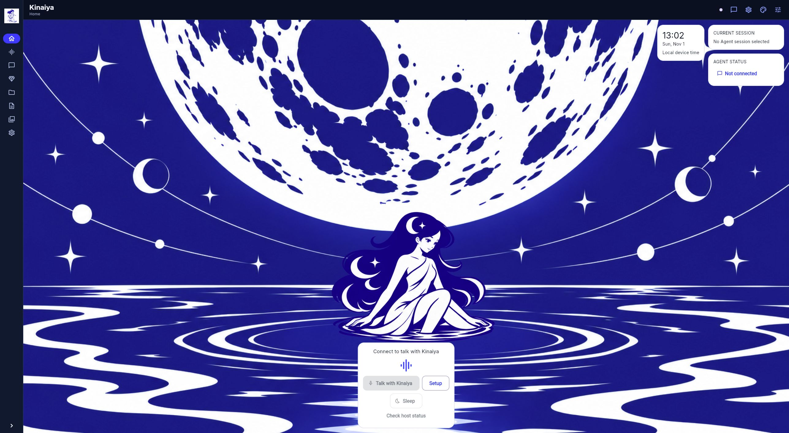
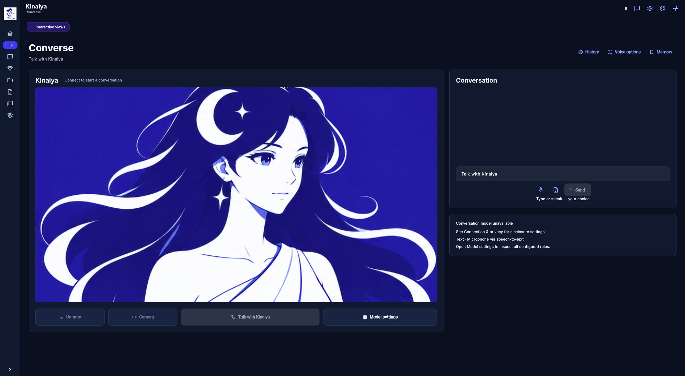
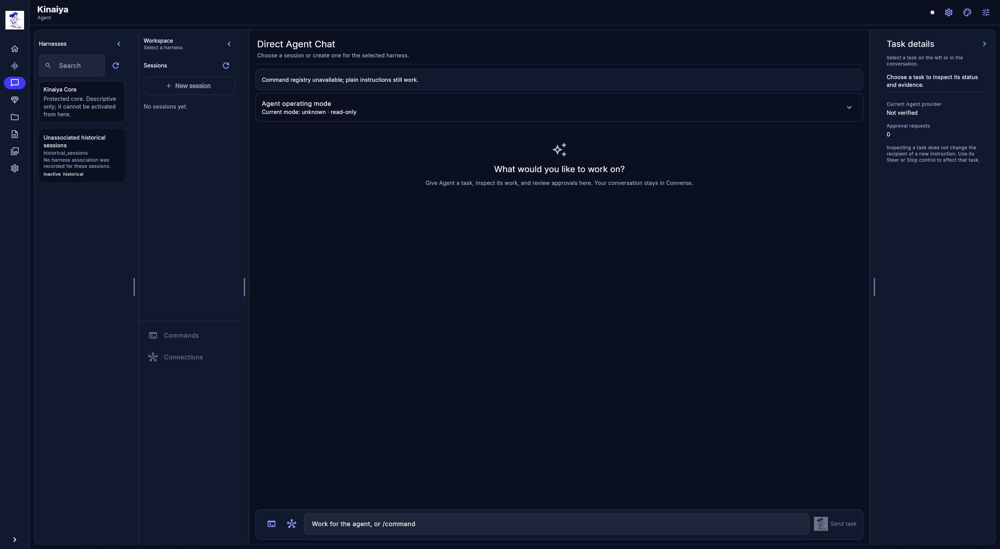
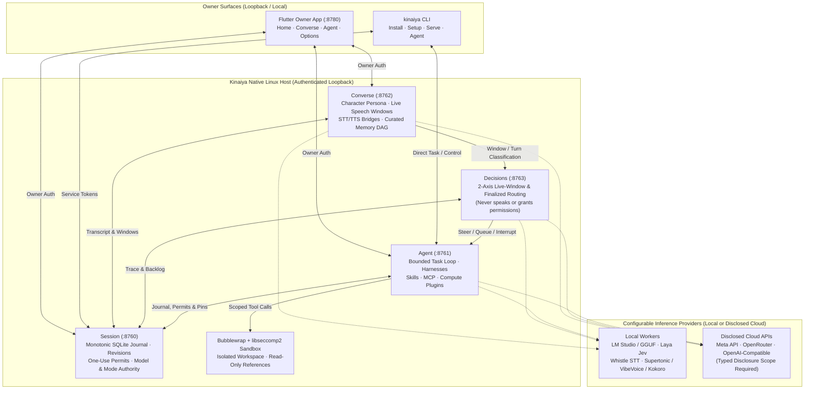
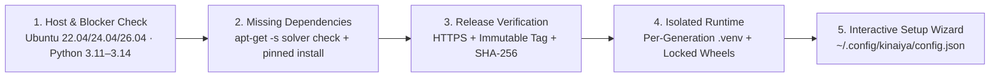
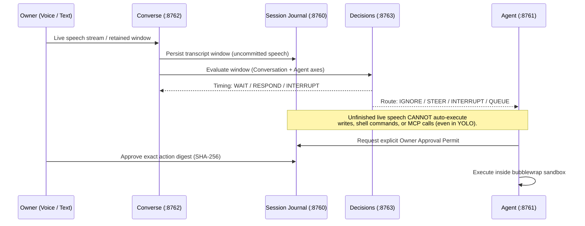

# Kinaiya

**A companion to talk to. An agent to get things done.**

Kinaiya pairs a customizable AI character (**Converse**) and an independent, sandboxed work agent (**Agent**) inside one local-first workspace. Talk or type through ideas with Converse, hand coding, research, and file tasks to Agent, and keep conversation and execution side by side—with the local or cloud models you choose.

> **For Hackathon Reviewers — Kinaiya in 30 Seconds:**
> - **Decoupled Dual-Loop Architecture:** **Converse** owns persona, voice, and live dialogue; **Agent** owns sandboxed tool execution (`bubblewrap` + `seccomp`); **Decisions** classifies and routes between them without speaking as the character or granting tool permissions.
> - **Cryptographic Action & Context Authority:** Model output never creates authorization. Every destructive or external action binds to a one-use `SHA-256(CanonicalJSON(tool, args, revision))` permit, exact native token admission, and typed disclosure scopes (`local-only` by default).
> - **Independently Usable:** Converse is optional. Agent remains fully operational for coding, repository analysis, and tool work when voice and character services are off.

[See the interface](#see-the-interface) · [System architecture](#system-architecture) · [Get started (1-command install)](#get-started) · [Run the host](#run-the-host) · [Hackathon target](#hackathon-target) · [Technical details](#technical-details) · [Mathematics](#mathematical-foundations) · [Roadmap](Roadmap.md)

---

## See the interface

| Home | Converse |
| --- | --- |
| <a href="assets/screenshots/2026-11-01-ui-refresh/home.jpg"></a> | <a href="assets/screenshots/2026-11-01-ui-refresh/converse.jpg"></a> |
| **Agent workspace** | **Options** |
| <a href="assets/screenshots/2026-11-01-ui-refresh/agent.jpg"></a> | <a href="assets/screenshots/2026-11-01-ui-refresh/options.jpg"></a> |

*Actual application captures, November 1, 2026, with services disconnected and an empty Agent workspace. Select an image to open the complete capture.*

- **More captures & provenance:** [Application screenshot gallery and SHA-256 capture manifests](assets/screenshots/README.md)
- **Design boards:** [Editable Penpot interface designs](assets/penpot/README.md) for Converse, Agent, Options, and intelligent views (design references with illustrative content)

---

## System architecture

Kinaiya splits conversation, routing, task execution, and durable state into four authenticated loopback services sharing a bounded, monotonically ordered transcript journal:



| Component | Default Port | Core Responsibility | Security & Authority Boundary |
| --- | --- | --- | --- |
| **Session** | `127.0.0.1:8760` | Persistent SQLite journal, sequence numbers, operating mode (`Off` / `On-Demand`), model/provider catalogs, and permit storage | Single source of truth for transcript ordering, task admission, and revision-bound settings receipts |
| **Agent** | `127.0.0.1:8761` | Direct chat, repository analysis, file edits, shell commands, harnesses, skills, and MCP tools | Executes shell commands inside `bubblewrap` + `libseccomp2`; requires explicit owner approval for unapproved writes/shell/MCP |
| **Converse** | `127.0.0.1:8762` | Character persona, voice input/output, live listening windows, interruption handling, and optional selected recall | Optional service; isolated from Agent tool permissions; never fabricates negative task outcomes |
| **Decisions** | `127.0.0.1:8763` | Classifies finalized turns (`ignore`, `queue`, `steer`, `interrupt`) and two-axis live speech windows | Advisory routing only; cannot speak as the character or authorize tool execution |
| **Owner Web UI** | `127.0.0.1:8780` | Prebuilt Flutter web interface served by `kinaiya web` | Loopback-confined static asset server; never exposes source directories or raw service tokens |

---

## Why Kinaiya

| Capability | What It Does |
| --- | --- |
| **Conversation alongside useful work** | Talk or type with **Converse**, then work directly with **Agent** or route a conversation request through **Decisions**. Task progress, approvals, and results stay inspectable in the Agent workspace. |
| **A character you can make your own** | Import a character pack, customize colors, and adjust captions, motion, sleeping/wake pose transitions, and audio-driven mouth movement while keeping persona separate from Agent's work. |
| **Models for different jobs** | Select local or cloud providers independently for Agent, Converse, Decisions, STT, and TTS. Configure per-harness primary and auxiliary reasoning models through Options. |
| **A place for ongoing projects** | Group Agent sessions into **Projects**, revisit task history, and inspect recorded outputs in the **Generated Documents** and **Generated Media** libraries with their source sessions. |
| **Results you can explore** | Experimental intelligent views bring structured tables and diagrams into the conversation, with pinned views and readable text fallbacks. |
| **Tools with visible controls** | Work with local skills, MCP connections, and isolated compute plugins. Inspect native availability, model context, and scoped `Allow` / `Deny` / `Ask` rules from Options. |

---

## Get started

Kinaiya runs on a native Linux host (**Ubuntu 22.04, 24.04, or 26.04**, `x86_64` or `aarch64`, `Python 3.11–3.14`) with a Flutter web interface. Other Linux distributions (such as Debian 12), WSL, macOS, and Windows are not qualified by the candidate installer. Read the [Linux installation and recovery guide](docs/linux-installation.md) for the complete first-use quickstart and recovery paths; **never run the installer as root**.

### Native Linux quick install (single command)

Run the single-command installer to check host prerequisites, print the installation plan before making changes, install any missing system dependencies (`bubblewrap`, `libseccomp2`, `python3.<minor>-venv`), verify and stage the release runtime in an isolated `.venv`, install the `~/.local/bin/kinaiya` launcher, and launch the interactive setup wizard:

```sh
# Interactive bootstrap + setup wizard (experimental nightly release channel):
curl -fsSL https://raw.githubusercontent.com/rgoza1996/Kinaiya/main/install.sh | sh -s -- --channel nightly

# Or review the printed JSON plan first without --yes (type 'no' at the prompt to exit with zero changes),
# or customize initial disjoint workspace and data directories:
curl -fsSL https://raw.githubusercontent.com/rgoza1996/Kinaiya/main/install.sh | sh -s -- \
  --channel nightly --workspace "$HOME/Kinaiya Workspace" --data-dir "$HOME/.local/share/kinaiya/data"
```



> [!IMPORTANT]
> **Dependency & System Update Policy (Solver-Verified No-Upgrade / No-Remove / No-Downgrade):**
> - **Installs missing dependencies only:** If `bubblewrap`, `libseccomp2`, or `python3.<minor>-venv` is missing, the CLI includes the non-mutating `apt-get -s` solver check and `sudo apt-get install --no-upgrade --no-remove -o APT::Get::Upgrade=false -o APT::Get::Remove=false -o APT::Get::Allow-Downgrades=false -y -- <missing>` in the confirmation plan. Before invoking `sudo`, it simulates the complete transaction against the `dpkg` status snapshot, verifies that every `Inst` record is a newly installed package with zero upgrades, removals, or downgrades, and binds the approved `package=version` pairs to the install command.
> - **Never updates or mutates existing system packages:** Because `apt-get --no-upgrade` alone only prevents upgrading packages explicitly named on the command line (and can still upgrade already-installed transitive dependencies), Kinaiya inspects the full solver transaction and **never** runs `sudo apt-get update` or `sudo apt-get upgrade`.
> - **Warns on out-of-date blockers:** If an existing system component (`Ubuntu < 22.04`, `Python < 3.11`, `bubblewrap < 0.6.1`, `libseccomp2 < 2.5`), a transitive dependency upgrade/removal/downgrade requirement, or a stale local package index blocks installation, the CLI and setup wizard stop before any mutating command and warn you to update that specific component first.

**Install locations, release channels & setup boundaries:**
- **Default XDG layout vs custom directories:** By default, managed code and per-generation `.venv` runtimes live in `~/.local/share/kinaiya/install`, private journals and tokens in `~/.local/share/kinaiya/data`, config in `~/.config/kinaiya/config.json`, cache in `~/.cache/kinaiya`, the launcher in `~/.local/bin/kinaiya`, and the Agent workspace in `~/Kinaiya Workspace`. You can pass custom absolute `--workspace` and `--data-dir` paths (including paths with spaces) to `install.sh`, provided all roots are disjoint and symlink-free; managed code and private data must stay outside the Agent workspace so Agent tools cannot modify trusted runtime code or credentials. *Planned (open PR, not on `main`):* an interactive choice between the default root and the invoking directory (#383).
- **Nightly (`--channel nightly`, experimental) vs Stable (default):** Nightly installs only a qualified, SHA-256-pinned GitHub release (scheduled for **midnight Las Vegas time (`America/Los_Angeles`)**, never arbitrary `main` commits). Stable is approval-gated; when no approved stable release is published yet, running without `--channel nightly` refuses rather than falling back to nightly. See [release policy and trust limits](docs/releases.md).
- **Saved configuration vs live inference:** `kinaiya setup` writes `~/.config/kinaiya/config.json` and generates private `0600` service tokens (`ready: false`, `provider_connection: "not_checked"`). It never downloads models, never accepts raw API keys on the command line (pass only an environment variable **name** via `--credential-env`), and does not test live inference until you start the host.

---

## Run the host

Once installed and configured, add `~/.local/bin` to `PATH`, start the loopback host services, and export your local owner login credential for the web UI:

```sh
# 1. Ensure ~/.local/bin is on PATH in the current shell:
export PATH="$HOME/.local/bin:$PATH"

# 2. If using a cloud provider, export the API key into the environment variable NAME you gave
#    setup (--credential-env) from your protected secret mechanism; never put raw keys in CLI flags.

# 3. Start Agent-only host services (Session :8760 + Agent :8761, plus Converse/Decisions if enabled in setup):
kinaiya serve host

# 4. In a second terminal, export the owner browser sign-in token to ~/.local/share/kinaiya/data/owner-login.txt (mode 0600):
kinaiya owner-login

# 5. Serve the matching release's prebuilt Flutter owner web UI on http://127.0.0.1:8780:
kinaiya web
```

- **Owner authentication vs internal service tokens:** Kinaiya manages internal service-to-service credentials in `~/.local/share/kinaiya/data/service-tokens.json` (`0600`); never edit or share that file. `kinaiya owner-login` exports only the `owner` bearer token to `~/.local/share/kinaiya/data/owner-login.txt` (or `--output <path>`, `0600`, without printing the token to stdout) so you can sign into the local web UI or authenticate owner API requests.

### Common CLI, setup & recovery commands

| Task | Command | Notes |
| --- | --- | --- |
| **Interactive setup wizard** | `kinaiya setup` | Prompts on `/dev/tty` for workspace, data dir, measured Agent adapter (`lmstudio` or `meta`), model, and optional Converse. |
| **Non-interactive local setup** | `kinaiya setup --yes --endpoint http://127.0.0.1:1234 --model <model-id>` | Configures local native LM Studio loopback (`allow_cloud: false`) without starting work. |
| **Non-interactive cloud setup** | `kinaiya setup --yes --endpoint https://api.meta.ai/v1 --model <model-id> --allow-cloud --credential-env MY_PROVIDER_KEY` | Records the env var **name** (`MY_PROVIDER_KEY`) and cloud disclosure consent; never pass a raw key. |
| **Start host services** | `kinaiya serve host` | Session (`:8760`) + Agent (`:8761`); adds Converse/Decisions only if enabled in setup. `serve all` remains a developer path. |
| **Send a direct Agent task** | `kinaiya agent "Write a small file"` | Connects directly to Agent (`:8761`). Unapproved writes/shell calls wait for owner approval. |
| **Export owner web login** | `kinaiya owner-login` | Writes a `0600` local credential file (`owner-login.txt`) for signing into the loopback web UI. |
| **Check installed version** | `kinaiya version` | Verifies and prints the active generation's immutable release receipt. |
| **Check / plan updates** | `kinaiya update --plan --channel nightly` | Read-only check (`--check` or `--plan`); never creates directories, downloads archives, or restarts services. |
| **Install verified update** | `kinaiya update --yes --channel nightly` | Stages new generation alongside current, verifies imports, and switches atomically (stop services first). |
| **Recover interrupted stage** | `kinaiya recover --yes` | Reconciles `pending.json` after an interrupted install/update while preserving `journal.sqlite` and workspace. |
| **Rollback code generation** | `kinaiya rollback --generation <32-hex-id> --yes` | Restores retained code/runtime generation only; never modifies or rolls back databases. |

Need to recover from a missing `bwrap` namespace policy, invalid API key, unreachable model endpoint, missing web bundle, or interrupted update? See [Troubleshooting and small recovery paths in `docs/linux-installation.md`](docs/linux-installation.md#troubleshooting-and-small-recovery-paths).

<details>
<summary><strong>Contributor / local source checkout verification commands</strong></summary>

When working directly in a repository checkout on Ubuntu 22.04/24.04/26.04 (`sh install.sh` or `scripts/install.sh` can also be run locally):

```bash
ruff check .
ruff format --check .
pytest -m 'not live' -q
```

 Setup and update do not prove provider/model readiness or start work. Optional [Converse setup](docs/converse-setup.md) and the [Flutter web client guide](apps/kinaiya_flutter/README.md) document optional voice/UI development workflows. Windows support is deferred; Android/iOS distribution and native calling remain separate qualification work.
</details>

---

## Hackathon target

The planned hackathon demonstration is a focused slice through the larger [Roadmap](Roadmap.md):

1. **Real voice conversation** with interruption support and an original, replaceable character.
2. **A real routed request** that uses shared conversation context via Decisions.
3. **Agent completes useful work** in its sandboxed workspace and reports verifiable evidence of the result.
4. **Direct Agent Chat remains available** while Converse is off.
5. **Self-building harness evaluation:** Agent generates an executable harness extension, evaluates it against a pinned baseline, and demonstrates safe rejection, promotion, or rollback.
6. **Verified Meta API integration (opt-in, provider-configurable core):** Demonstrated against live Meta Responses, `/v1/responses/input_tokens` exact prompt-count admission, buffered Meta STT (`muse-voice-transcribe-1.0`), and typed `action_format: "typed-v2"` structured actions on public/synthetic inputs through the local admission proxy — see [ADR 0002 (real-provider integration gate)](docs/adr/0002-verified-integration-slice.md), [ADR 0061 (explicit Meta Converse & exact prompt measurement)](docs/adr/0061-explicit-meta-converse.md), [ADR 0072 (typed Meta action wire)](docs/adr/0072-typed-meta-action-wire.md), [ADR 0083 (synthetic multimodal qualification)](docs/adr/0083-synthetic-multimodal-qualification.md), [bounded budget accounting](docs/meta-budget-tests.md), and the retained [Stage B live run receipt](evaluation/evidence/stage-b-2026-10-26.json). Meta remains an explicit opt-in provider behind typed disclosure scopes (`allow_cloud`), not a hard product dependency; physical microphone/camera calling, live provider billing, and full end-to-end demo qualification remain separate open gates.

### Current stage & qualification matrix

**Experimental and actively developed.** The [implementation ledger](docs/implementation-status.md) and [Roadmap 0.3.2](Roadmap.md) distinguish implemented capabilities, measured experiments, and remaining acceptance gates:

| Subsystem | Implemented & Verified in CI | Experimental / Research Evidence | Open Acceptance Gates |
| --- | --- | --- | --- |
| **Core & Session (`:8760`)** | Monotonic SQLite journal, revision-bound settings receipts, service token auth, typed disclosure scopes | Bounded Converse memory DAG (`--converse-memory`) and selected local recall | Automatic memory extraction, relevance ranking, schema migration tooling |
| **Agent (`:8761`) & Sandbox** | `bubblewrap` + `libseccomp2` isolation (`x86_64` & `aarch64`), one-use SHA-256 action permits, native submit admission, `Off`/`On-Demand` mode control | Isolated context-selector harnesses, compute-plugin host, local `/skills` and `/mcp` management | General autonomous improvement (12-case screen rejected candidate), full MCP OAuth conformance |
| **Converse (`:8762`) & Voice** | Retained live-listening windows, audio-clock mouth motion, sleeping/wake scene, complete-prompt context budgeting | GPU Whisper/Kokoro profile, CPU Whistle STT, Supertonic 3 CPU, VibeVoice 0.5B CPU, OpenRouter TTS, GGUF worker | Sustained realtime CPU voice latency, 8 GB combined GPU voice qualification, clean-machine model installer |
| **Decisions (`:8763`)** | Finalized-message routing (`ignore`/`queue`/`steer`/`interrupt`), two-axis live-window routing, owner trace inspection API | Typed local Laya Jev worker with pinned snapshot verification, synthetic multimodal probes | Promotion of Laya as reference default, calibrated probabilistic routing |
| **Distribution & Clients** | Native Linux single-command installer/updater/rollback (`Ubuntu 22.04/24.04/26.04`), Flutter web UI, deterministic Android APK & iOS sideload IPA bundlers | Scheduled midnight-Pacific (`America/Los_Angeles`) nightly pipeline, GitHub OIDC build-provenance attestations | Production store signing secrets, physical clean-device mobile & desktop voice qualification |

---

## Technical details

The subsections below preserve the complete architectural notes, operational constraints, and ADR references for every subsystem.

### Project principles

- Keep the voice experience and work agent independently usable.
- Make permissions and action results explicit; model output cannot create user authorization.
- Preserve provider portability and clearly distinguish verified integrations from targets.
- Measure the adaptive-harness claim against pinned baselines and safe rollback behavior.
- Keep prototype evidence, recorded demos, fixtures, and implemented functionality clearly labeled.

### 1. Live-window routing & unfinished speech authority



- **Retained transcript windows:** Live listening uses retained transcript windows with separate Decisions outputs for conversation timing and Agent routing. It can hold a prepared reply for a speaking opening, preserve speech during backchannels, steer/cancel work, and queue follow-ups until a native task boundary. See [streaming-window design and verification limits](docs/adr/0019-streaming-window-control.md).
- **Unfinished speech approval boundary:** Unfinished live speech requires owner review before file writes, shell commands, or MCP calls, including with broad tool grants or YOLO. Agent Chat shows current approvals across conversation sessions. Silence alone does not commit speech; see the [source-authority boundary](docs/adr/0020-streaming-source-authority.md).
- **Typed Laya Decisions adapter:** An opt-in [typed Laya Decisions adapter](docs/adr/0021-laya-decisions.md) supports local Jev inference in a separate process, with native source/task bindings and explicit classification refusals. The optional [verified local worker](docs/laya-worker.md) loads a private snapshot of pinned model files and checks artifact identity on every response without inventing a Hub revision. Base-model and supervised synthetic results remain research evidence; Laya is not yet promoted as the reference default.
- **Decisions owner trace inspection:** The [Decisions owner window](docs/adr/0066-decisions-owner-window.md) reads actual provider-bound captures through the [private inspection API](docs/decisions-trace-api.md): literal submitted scripts, raw/validated outputs, historical identities, and bounded session/date filters. Missing historical capture stays unavailable; direct Agent observations explicitly show no Decisions inference. This inspection slice does not establish overall routing/model-quality acceptance.

### 2. Sandboxed Agent execution, admission & task retirement

- **Service ports & workspace separation:** Services bind loopback: session `8760`, Agent `8761`, Converse `8762`, and Decisions `8763`. `kinaiya serve agent` and `kinaiya serve converse` also start independently alongside storage. `kinaiya agent "Write a small file"` connects directly to Agent. Unapproved writes and shell calls wait for an action-specific owner approval. The worker workspace must be separate from core, evaluation, settings, and credential directories.
- **File-write argument validation:** Agent [file-write arguments](docs/adr/0043-write-file-arguments.md) use explicit path and content strings and are checked before approval and dispatch. Optional legacy revision metadata is validated against the native task revision and stays bound to the exact approval digest. Malformed writes produce an unsuccessful observation for the bounded task loop.
- **Operating-mode control (`Off` / `On-Demand`):** Agent Chat's [operating-mode control](docs/agent-control-api.md) reads and changes native Off/on-demand independently of Converse. Off refuses new tasks and steering; already accepted work may finish under its existing authorization, and Stop and approvals remain available. Autonomous is unavailable pending a standing-work producer.
- **Native submit admission:** Initial Agent submissions use [native admission](docs/adr/0087-agent-submit-admission.md) to commit the journal entry and its logical idempotency slot together. An unconfirmed acknowledgment stays paused and returns an explicit `HTTP 503`; a RAM entry alone cannot establish acceptance. Exact retries reconcile the original native identity and model pins without starting another worker. Only the direct validated creation receipt can start work after fresh authority checks; a retained or recovered receipt grants no execution. Upgrade requires quiescing old Agent and Session writers because generic initial-submit append is no longer accepted. This does not provide exactly-once third-party tool effects or automatic resume.
- **Recovered task retirement:** Recovered paused work supports owner [native retirement](docs/adr/0018-recovered-task-retirement.md) after a session reset. Its durable receipt keeps the original task identity and records unreconciled effects without copying old execution context into the new epoch. Unacknowledged retirement stays paused until explicitly reconciled; MCP management remains blocked while any work is nonterminal.
- **Complete-context admission:** Agent's [complete-context admission](docs/adr/0075-complete-agent-context.md) preserves complete native file observations and selects whole action/result exchanges using an exact count of the complete proposed request. The trusted instructions, current objective/revision, and newest exchange remain protected. Meta Agent profiles need an explicitly verified `context_tokens` value and the native count endpoint; unsupported complete-count providers refuse visibly. Generic compatible HTTP alone does not establish this capability. Every count and generation also needs a fresh native source admission. These mechanisms do not establish general Agent task reliability or complete the M1 gate.

### 3. Owner UI, Options workspace & revision-bound model controls

- **Flutter web client:** The [Flutter web client](apps/kinaiya_flutter/README.md) provides Character View, voice recording/playback, and independent Agent Chat. Its [design and browser evidence](docs/adr/0005-flutter-voice-client.md) describe the tested synthetic voice-to-file flow and Agent operation while Converse was unloaded. Native voice and the remaining M5 gates are unfinished.
- **Options workspace & per-role model catalogs:** The owner app's [Options workspace](docs/adr/0077-options-workspace-and-harness-models.md) uses persistent section navigation and embeds the appearance, voice, memory, connection, and MCP editors. Models, Providers, and Harness Customization are separate pages. Native revision-bound Agent defaults and per-harness model/reasoning overrides affect new tasks; accepted tasks retain their provider and inspectable model pin. The [owner API](docs/agent-options-api.md) persists settings and receipts without placing active provider credentials in model preferences.
- **Bound settings writes & recovery:** New model saves bind the observed backend and writer generation; [exact uncertain-save recovery](docs/adr/0088-bound-model-settings-writes.md) keeps the original owner/backend scope across reconnects and does not reapply a historical preference. Older unbound requests are exact-replay-only. Execution preferences use their own [bound recovery](docs/adr/0090-bound-execution-settings-writes.md) and database identity, with exact historical receipts and a shared bounded settings transport pool. Runtime version 1.0 retains its existing first-write and replay behavior; new UI writes require observed runtime authority.
- **Independent role editors (Agent, Converse, Decisions, STT, TTS):** The [Providers catalog](docs/adr/0086-owner-provider-catalog.md) adds native profile and protected credential-generation forms. [Agent model selection](docs/adr/0089-agent-catalog-models.md) captures exact saved versions in fresh task-owned primary/auxiliary adapters; saving a provider profile alone does not select it. Independent [Converse text model settings](docs/adr/0091-converse-text-model-settings.md) select an eligible exact catalog generation while actual Converse operations and cleanup are settled. Independent [Decisions](docs/adr/0098-independent-decisions-model-selection.md), [STT](docs/adr/0099-independent-stt-model-settings.md), and [TTS](docs/adr/0101-independent-tts-model-settings.md) editors select supported host or eligible catalog configurations through their own native owners. These supersede the earlier host-managed-only editing limitation; configuration does not establish model readiness. Local voice/profile reconfiguration, broader provider support, and the runtime/concurrency acceptance described in the ADRs remain separate work.
- **Task-pinned auxiliary models:** Global and per-harness [auxiliary text models](docs/adr/0082-task-pinned-auxiliary-models.md) support explicit analysis, compression, title, delegated reasoning, and harness design side calls. Native task pins, measured admission, and disclosure remain authoritative; these calls cannot execute tools or grant permissions.
- **Home, Converse, sidebars & visual controls:**
  - The [options catalog](docs/options.md) distinguishes implemented, host-managed, and planned controls. Stable semantics use the [supplied Penpot presentation](docs/adr/0054-penpot-owner-interface.md).
  - The [updated Home and optional Converse design](docs/adr/0059-home-and-optional-converse.md) shares one live conversation owner: Home keeps the seated water scene, while the optional interaction view adds close-up artwork, transcript, and composer. Home's mascot/Setup opens model declarations and local view visibility. Text model choice lives in Options / Models; camera/direct-audio input remains unavailable in the production app.
  - Owner Projects group Agent sessions; Generated Documents and Generated Media list native output receipts with time, type, and source session. These libraries do not scan workspace folders or grant file access.
  - The [synthetic multimodal qualification](docs/adr/0083-synthetic-multimodal-qualification.md) records local LFM3/Gemma/d1 and Meta API observations, exact inputs, and failed checks. Those probes do not enable camera capture or establish production multimodal readiness; [the remaining gates](https://github.com/rgoza1996/Kinaiya/issues/204) include actual owner-armed transport and a labelled routing/quality matrix.
  - The [setup bubbles](docs/adr/0063-floating-setup-bubbles.md) start in fresh random positions and drift slowly. Hover/focus holds only the affected bubble; dragging and bounded flinging, bubble-to-modal growth, a floating Close control, and empty-space dismissal honor motion preferences and preserve voice Stop controls.
  - Agent has [two independently collapsible sidebars](docs/adr/0065-agent-sidebars.md): Harnesses and the selected harness's Workspace/sessions. Native eligibility and immutable session/task pins govern selection; a host with no configured selector registry exposes Seed Agent and legacy unassociated sessions remain unassociated. Current generated entries are bounded context selectors, not complete generated Agent runtimes.
  - The close-up's [mouth motion](docs/adr/0064-speech-mouth-playback.md) follows actual decoded/playback-clock audio; optional visemes require real timing data. Newer design-chat hair/mole/highlight reference artwork remains pending pack integration.

### 4. Converse memory DAG, context budgeting & publication guards

- **Converse memory core (`--converse-memory`):** An experimental [Converse memory core](docs/adr/0047-converse-memory-core.md) is installed only with `kinaiya serve session --converse-memory` (or the same switch on `serve all`). Its owner-only API starts each current Converse namespace disabled. Explicitly enabled namespaces accept local owner-curated, transcript-pinned claims and hard dependencies, reconcile corrections and contradictions, retrieve complete bounded dependency sets, and forget retained content. Disabling use and deleting data are separate controls. Agent and Decisions do not use this DAG.
- **Selected recall runtime:** The first [selected recall runtime](docs/adr/0051-converse-selected-recall.md) adds owner-only Converse `POST /v1/memory/state` and `/v1/memory/use` controls. Runtime use starts off after every restart and is separate from the persisted namespace enable/retention setting. The owner selects existing note IDs; a local provider must measure the complete proposed prompt before either typed or live window generation uses the complete dependency set. Unsupported counting, unavailable memory, or insufficient context omits recall. Provenance checks exclude old memory-derived assistant history after off, replacement, or invalidation while keeping the authoritative transcript inspectable. In-flight work may remain pending after off; cancellation does not prove a journal write failed.
- **Owner Memory dialog & note editor:** The experimental owner [Memory dialog](docs/adr/0052-converse-memory-owner-ui.md) in Character View browses and inspects existing notes, controls saved access, and explicitly selects up to eight active notes for use or stops using them. Opening it only reads the current scope. The owner-only Session catalog is complete and bounded; disabled listing does not reconcile sources or write data. Unconfirmed changes retain bounded RAM latches across dialog close/reopen and same-endpoint reconnect; unchanged refresh values cannot settle an old write. Namespace access and runtime use remain separate. The owner can [create a transcript-pinned note, create a revised note, and explicitly forget a note](docs/adr/0085-converse-note-editor.md). Revision creates another immutable note; forgetting the original is a separate action. Exact historical receipts help reconcile uncertain saves without recreating erased content. Automatic extraction, relevance ranking, and improved human recall remain unfinished.
- **Converse history budgeting & prompt measurement:**
  - Production Converse [history budgeting](docs/adr/0057-converse-context-window-budget.md) uses the active model's complete formatted prompt count and reserved output space. Semantic native pages preserve corrections and playback qualifications while routing traffic consumes no dialogue allowance. It retains whole recent messages that fit, rather than eight live or twelve typed entries. The local native `lmstudio` provider uses the exact already-loaded instance for counting and generation, without JIT loading. Providers lacking exact counting visibly refuse this host path; a compatible HTTP endpoint alone is insufficient. Embedded runtime compatibility remains separately identified in health. Conversation quality and physical latency still require human testing.
  - An optional [whole-chat prompt measurement](docs/adr/0050-converse-prompt-measurement.md) uses only an already resident managed GGUF worker, without generating a reply or loading a model. Its result binds the complete chat request and protected profile and accounts for reserved output when checking context capacity. Unsupported counting refuses without a guessed estimate. The installed fork's count route has not been exercised; synthetic transport tests do not establish compatibility. Selected memory recall depends on this optional capability; an unsupported installed counter leaves ordinary dialogue available without recalled content.
- **Negative runtime-state publication guard:** A bounded [runtime-state publication guard](docs/adr/0042-negative-runtime-state-publication.md) substitutes uncertainty for selected unsupported negative Agent/task claims in generated Converse chunks. It preserves the existing native outcome evidence path. Its finite English matching does not qualify a model or establish general dialogue truthfulness.

### 5. Voice backends, local inference workers & resource handoffs

| Profile / Backend | Role | Execution Mode | Status & Qualification Notes |
| --- | --- | --- | --- |
| **Kokoro + Whisper (`voice` extra)** | TTS + STT | Separate Python (`python -m packages.providers.voice_worker`) | Preinstalled weights; model downloads disabled by default. [Explicit GPU profile](docs/adr/0056-explicit-gpu-converse.md) verifies CUDA/ROCm buffers and refuses CPU fallback ([#132](https://github.com/rgoza1996/Kinaiya/issues/132)). |
| **Whistle CPU STT** | STT | Owned native process ([ADR 0034](docs/adr/0034-managed-whistle-cpu-stt.md), [ADR 0036](docs/adr/0036-incremental-whistle-stt.md)) | Bounded PCM WAV slices with cancellation/recovery. Incremental 2-CPU profile is too slow for realtime speech; streaming transport remains open. |
| **Supertonic 3 CPU** | TTS | Pinned local assets ([ADR 0027](docs/adr/0027-retained-supertonic.md)) | Buffered output before transport; synthetic screen does not establish warm-onset or physical audible latency. |
| **VibeVoice Realtime 0.5B** | TTS | CPU Transformers 5.21 derivative ([ADR 0029](docs/adr/0029-vibevoice-transformers5.md)) | Request-owned chunk cancellation. Synthetic 9-reply screen: median first PCM `226 ms`, first non-silent frame `2.88 s`, `RTF 2.60` (not realtime). |
| **OpenRouter Kokoro TTS** | Cloud TTS | HTTPS w/ dedicated credential & byte ledger ([ADR 0062](docs/adr/0062-explicit-openrouter-tts.md)) | Authorizes each persisted reply's disclosure scope; no silent local TTS fallback. |
| **Managed GGUF Text** | Converse LLM | Opt-in native SSE worker ([ADR 0040](docs/adr/0040-managed-native-text.md)) | Shares lifecycle ownership with Qwen profile; initial implementation/verification is CPU-only. |

<details>
<summary><strong>Detailed voice & resource coordinator notes</strong></summary>

- Optional voice runs in a separate Python with the `voice` extra and preinstalled Kokoro/Whisper weights: `python -m packages.providers.voice_worker`. Model downloads are disabled by default; a clean-machine model installer is still a roadmap task.
- An explicit [GPU voice profile](docs/adr/0056-explicit-gpu-converse.md) selects pinned OpenAI Whisper tiny/tiny.en and Kokoro on CUDA or AMD ROCm, verifies loaded parameters and buffers, and refuses CPU fallback. It supports a local GPU dialogue provider with thinking disabled. Combined VRAM and native execution evidence are tracked in [#132](https://github.com/rgoza1996/Kinaiya/issues/132); a development-GPU measurement does not establish constrained 8 GB hardware acceptance.
- [Ming 3 Tiny](https://github.com/rgoza1996/Kinaiya/issues/72) remains a retained candidate with an unconfigured backend; full M2 acceptance remains open.
- An opt-in [CPU voice resource coordinator](docs/adr/0013-resource-handoff.md) can own that worker, verify process release for an explicit local-work handoff, and restore voice when a bound Agent task finishes. Optional [managed Laya residency](docs/adr/0022-managed-laya-resources.md) adds pinned worker ownership, AMD driver telemetry, and explicit GPU headroom admission. `/resources` controls stay in Agent Chat; approvals remain usable while Converse is paused. General GPU scheduling, other local text-model unloading, and complete M6 reliability remain open. [Durable owner intent](docs/adr/0023-converse-owner-intent.md) keeps acknowledged Converse-off choices effective through restoration and restarts.
</details>

### 6. Skills, MCP, compute plugins & disclosure scopes

- **Local skills (`/skills`):** Enabled with `"skills": {"enabled": true}` in owner configuration. `/skills list`, `/skills install <local-path>`, and `/skills enable <qualified-id>` manage packages without inference; `/skill <qualified-id> [request]` starts normal Agent work with selected, pinned instructions. Packages default to `local-only` disclosure. See the [Agent skill boundary](docs/adr/0010-agent-skills.md).
- **MCP connections (`/mcp`):** Optional [MCP connection management](docs/adr/0017-mcp-management.md) is enabled by `"mcp": {"enabled": true}` after installing the ecosystem extra. Agent `/mcp` commands and **MCP connections** settings configure disabled profiles, test connections, enable, reconnect, disable, and remove servers without inference. Configuration changes use explicit task boundaries and durable request identities; stop/status and permission revocation remain available. Only reviewed environment secret references are accepted. OAuth and complete MCP/skill ecosystem conformance remain open.
- **Isolated compute plugins (`/plugins`):** An optional [isolated compute-plugin host](docs/adr/0016-compute-plugins.md) retains ordinary Python/JSON algorithms independently of the LLM that authored them. Owner-held acceptance suites and reviewed promotion gate activation; `/plugins` controls and direct owner invocation require no inference. Agent can discover and call approved versions with task pins and native result receipts. The [public CSV acquisition evidence](evaluation/evidence/compute-plugins-2026-10-27.json) records real source generation, isolated execution, rejected updates, and rollback. General dependency installation, hooks, foreign plugin adapters, and full autonomous capability acquisition remain open.
- **Credentials, live testing & typed disclosure scopes:**
  - Provider keys belong in secret references/environment variables. Development Meta Contributor profiles are for public code and synthetic inputs only. The live test requires an explicit paid-inference flag and a budget proxy; ordinary CI is offline with respect to inference. See [integration evidence and limits](docs/adr/0002-verified-integration-slice.md) and the [threat model](docs/security/threat-model.md).
  - [Native disclosure scopes](docs/adr/0037-typed-disclosure-scopes.md) default typed input, tasks, and legacy unscoped history to `local-only`. Public/synthetic and private-cloud input require explicit grants; Contributor accepts only the `public_synthetic` grant. Drafts and recordings keep their capture-time scope when providers change. CLI cloud work must specify its input grant explicitly, for example:
    ```bash
    kinaiya --content-scope public_synthetic agent "Read the synthetic fixture"
    ```

### 7. Roadmap & implementation ledger provenance

The [Roadmap 0.3.2](Roadmap.md) retains the October 30 reconciliation, October 31 model-choice/performance clarification, and November 1 optional Omni Converse paths. The [implementation and acceptance ledger](docs/implementation-status.md) retains a historical runtime cutoff at source `f92f6d1` and separately records later bounded increments; read those addenda and their ADRs for subsequent changes, not as a freshly requalified full-product snapshot. Partial resource/ecosystem/mobile foundations do not establish completion of the full product scope.

---

## Mathematical foundations

Kinaiya combines discrete-state coordination, cryptographic integrity, budget-constrained execution, streaming inference, and adaptive-harness research. The equations below distinguish **what the experimental code enforces** from **what the roadmap proposes to evaluate**. Proposed formulations illustrate possible research methods; they are **not implemented algorithms or measured performance claims**.

| # | Foundation | Enforced in Code Today | Proposed Research Formulation | Primary Code Module |
| --- | --- | --- | --- | --- |
| **1** | [Decisions routing](#1-decisions-risk-aware-conversational-routing) | Finalized 4-way & live 2-axis window classification | Risk-sensitive Bayes loss minimization $L(a,y)$ | [`services/decisions/window_routing.py`](services/decisions/window_routing.py) |
| **2** | [Transcript budget](#2-shared-transcript-context-selection-under-a-token-budget) | Exact native prompt count $T_{\mathrm{native}}(P_k)+R\le W$ | 0–1 knapsack utility selection | [`packages/providers/prompt_budget.py`](packages/providers/prompt_budget.py) |
| **3** | [Event & permit binding](#3-event-consistency-ordering-revisions-and-authorization) | Monotonic journal + one-use `SHA-256` action permits | — (Implemented invariant) | [`core/policy/__init__.py`](core/policy/__init__.py) |
| **4** | [API admission economics](#4-api-economics-conservative-admission-control) | Conservative Meta ($25 ceiling) & OpenRouter TTS byte ledgers | — (Implemented in dev proxy/ledger) | [`scripts/muse_budget_proxy.py`](scripts/muse_budget_proxy.py) |
| **5** | [Streaming latency & RTF](#5-streaming-conversation-latency-and-real-time-factor) | Chunked streaming & audio-clock playback | Critical-path pipeline bounds & $\mathrm{RTF}<1$ target | [`services/converse/runtime.py`](services/converse/runtime.py) |
| **6** | [GPU/CPU resource handoff](#6-local-inference-gpu-resource-admission) | Measured RAM/VRAM headroom checks after worker release | Multi-worker VRAM component accounting | [`services/resources/coordinator.py`](services/resources/coordinator.py) |
| **7** | [Self-building harnesses](#7-self-building-harnesses-controlled-optimization-and-evaluation) | Protected evaluator, paired screening, promotion & rollback | Constrained quality optimization $\max_{H} \mathbb{E}[Q(H,x)]$ | [`harnesses/seed/__init__.py`](harnesses/seed/__init__.py) |
| **8** | [Converse memory DAG](#8-converse-memory-bounded-dependency-graphs) | Acyclic ordinal bounds ($d(v)\le 16$, $|Q(S)|\le 64$, $16\text{ KiB}$) | Automatic extraction & relevance ranking | [`services/session/memory.py`](services/session/memory.py) |
| **9** | [Admission & disclosure](#9-native-work-admission-permission-precedence-and-disclosure) | Mode gate, scoped rule precedence, lattice join $\max_{\preceq}\{\sigma_i\}$ | — (Implemented authority invariant) | [`packages/providers/disclosure.py`](packages/providers/disclosure.py) |
| **10** | [Theoretical limits of self-improvement](#10-theoretical-limits-of-self-improvement) | No universal correctness or optimality claim | Undecidability, incompleteness & specification limits | Research caveat (not a runtime guarantee) |

### 1. Decisions: risk-aware conversational routing

**Status:** Finalized-message routing and two-axis live-window routing are implemented experimentally; calibrated probabilistic decision theory is proposed.

The finalized-message classifier chooses among ignore, queue, steer, and interrupt.
Live windows instead produce separate conversation-timing and Agent-routing labels:

$$
(c_t,a_t)\in\mathcal C_{\mathrm{live}}\times\mathcal A_{\mathrm{live}}.
$$

- Conversation: `IGNORE`, `WAIT_FOR_NEXT_WINDOW`, `RESPOND_INTERRUPT_USER`, or `RESPOND_WITHOUT_INTERRUPTING_USER`.
- Agent: `IGNORE_FOR_IMMEDIATE_ROUTING`, `STEER_CURRENT_TASK`, `INTERRUPT_CURRENT_TASK`, or `QUEUE_UNTIL_TASK_DONE`.

Two outputs do not imply statistical independence. A classification neither grants
permission nor proves execution or completion. Recorded application requires a
matching native acknowledgment; an acknowledgment timeout can leave the outcome
unknown rather than rejected.

For the finalized-message labels, a possible risk-sensitive decision rule is:

$$
\mathcal{A}=\{\mathrm{ignore},\mathrm{queue},\mathrm{steer},\mathrm{interrupt}\},
\qquad
a_t^*=\arg\min_{a\in\mathcal A}\sum_{y\in\mathcal A}
P_\theta(y\mid x_t,H_t,z_t)L(a,y).
$$

Here $x_t$ is the current message, $H_t$ is relevant conversation history, $z_t$ is task state, and $L(a,y)$ penalizes choosing route $a$ when the appropriate route is $y$. Missing a cancellation may deserve a larger penalty than an unnecessary interruption. **This loss-based decision rule is a proposed formulation**, not a claim about the current classifier or calibration; model confidence is not automatically a probability. Routing never grants tool permissions.

[Decisions runtime](services/decisions/runtime.py) · [Live-window routing](services/decisions/window_routing.py) · [Routing design](Roadmap.md#6-asynchronous-decisions)

### 2. Shared transcript: context selection under a token budget

**Status:** Persistent retrieval and complete-request token admission are implemented experimentally; utility-optimized snippet selection remains research.

The measured admission constraint uses the complete formatted prompt $P_k$, the
reserved output $R$, and the selected model's context capacity $W$:

$$
T_{\mathrm{native}}(P_k)+R\le W,
\qquad h=W-T_{\mathrm{native}}(P_k)-R\ge0.
$$

The count binds to the exact request and model configuration. Converse drops
whole oldest messages; Agent drops whole oldest action/result exchanges while
protecting the newest exchange, trusted instructions and current objective.
Required counting failures, stale bindings and protected overflow refuse measured
admission rather than invent token estimates. Optional selected memory recall has
its own omission path when counting or context capacity is unavailable.

For recorded selection observations,
$N_{\mathrm{kept}}+N_{\mathrm{dropped}}=N_{\mathrm{examined}}$; examined history is
not necessarily the entire transcript. This chronological policy does not solve
an optimization problem. As a separate **research formulation**, selecting useful
snippets can be modeled as a 0–1 knapsack problem:

$$
\begin{aligned}
\max_{\mathbf{s}}\quad &\sum_{i=1}^{n}v_i s_i\\
\text{subject to}\quad &\sum_{i=1}^{n}c_i s_i\le B,\qquad s_i\in\{0,1\}.
\end{aligned}
$$

$v_i$ is a snippet's estimated utility, $c_i$ its token cost, $B$ the token budget, and $s_i$ whether to include it. This **illustrates the planned context-selection experiment**; the existing journal enforces limits and retrieval filters but does not solve this optimization problem.

[Journal implementation](services/session/store.py) · [Exact prompt measurement](packages/providers/prompt_budget.py) · [Converse budget](services/converse/context_budget.py) · [Agent budget](services/agent/history_budget.py) · [Harness experiment](Roadmap.md#123-first-executable-experiment)

### 3. Event consistency: ordering, revisions, and authorization

**Status:** Implemented invariants and cryptographic action binding.

The journal assigns monotonically increasing sequence numbers, consumer cursors cannot retreat, and applied task steering increments the objective revision:

$$
s_{i+1}>s_i,\qquad c_{t+1}\ge c_t,\qquad r_{\mathrm{new}}=r_{\mathrm{old}}+1.
$$

An action-specific approval is tied to the tool name, normalized arguments, and
objective revision, serialized as canonical JSON (the wire digest has a `sha256:` prefix):

$$
h=\mathrm{SHA256}(\mathrm{CanonicalJSON}(a,\mathrm{Normalize}(\theta_a),r)).
$$

A necessary permit predicate for an existing record is:

$$
\begin{aligned}
\mathrm{Usable}(p,a,\theta_a,r,t_{\mathrm{wall}},t_{\mathrm{mono}})\iff{}&
p.h=h(a,\theta_a,r)\land p.r=r\\
&\land\neg p.\mathrm{used}\land p.\mathrm{retired}=\varnothing\\
&\land t_{\mathrm{wall}}\lt p.e_{\mathrm{wall}}\\
&\land(p.e_{\mathrm{mono}}=\varnothing\lor t_{\mathrm{mono}}\lt p.e_{\mathrm{mono}}).
\end{aligned}
$$

The monotonic deadline applies when present. This predicate is **not sufficient
authorization**: the supervisor also rechecks native task/source currentness,
applicable permissions, action arguments and tool availability before effects.
Owner review and final one-use consumption are separate. Renewal creates a new,
unapproved permit rather than restoring the old approval; revocation retires the
permit. An uncertain journal acknowledgment does not undo native broker state or
prove a third-party effect failed. Hashing binds an action; it neither grants
permission nor establishes exactly-once external effects.

[Journal implementation](services/session/store.py) · [Policy and approvals](core/policy/__init__.py)

### 4. API economics: conservative admission control

**Status:** Implemented in a development-only Meta API budget proxy; not live provider billing.

For reported input tokens $I$, output tokens $O$, and cached input tokens $K$, the proxy preserves an ordinary-Spark comparison and a Contributor estimate using its configured dollar-per-million-token constants:

$$
\widehat C_{\mathrm{ordinary\ comparison}}=\frac{1.25I+4.25O}{10^6},
\qquad
\widehat C_{\mathrm{contributor}}=
\frac{0.10(I-K)+0.002K+0.20O}{10^6}.
$$

For settled responses with validated usage and exact requested/resolved Contributor identity, admission uses twice the cache-aware Contributor estimate. The earlier uncached admission estimate remains a separate audit counter. Unexplained legacy charges, incomplete usage and uncertain reservations are preserved; real reported billing remains a floor. Each future text request still reserves the full uncached catalog context plus bounded output at twice Contributor rates. Text retains a $22 sublimit and buffered voice a $3 sublimit. All settled estimates, outstanding reservations and the next reservation must fit the retained combined ceiling, at most $25. `--limit-usd 10` lowers that existing ceiling without resetting earlier spend or reservations; a later argument cannot raise it.

$$
\max(\widehat C_{\mathrm{settled}},C_{\mathrm{billing}})+C_{\mathrm{reserved}}+C_{\mathrm{next}}\le C_{\mathrm{owner\ ceiling}}.
$$

The [Meta pricing page](https://dev.meta.ai/docs/pricing-rate-limits) was verified on October 31, 2026. These calculations remain estimates, **not provider invoices**. Hosted text tools with additional fees are refused; Muse's local function tools remain available, including bounded namespace groups emitted by the CLI. The validator examines tool declarations without interpreting function parameter schemas as tools. No cache discount is assumed before a response reports it. Optional single-image SAM/Muse Image smoke routes have a separate $0.10 sublimit and are disabled by default; see [bounded testing and accounting](docs/meta-budget-tests.md).

The separate OpenRouter TTS ledger conservatively bounds admitted UTF-8 bytes,
not provider-reported character billing:

$$
\widehat C_{\mathrm{TTS}}=
\frac{0.62}{10^6}\left(\sum_j b_j+b_{\mathrm{next}}\right)\le L,
\qquad b_j=|\mathrm{UTF8}(\mathrm{text}_j)|.
$$

Here $L$ is its configured owner limit. Cancelled and uncertain admitted calls stay
charged in this ledger; the rate is an implementation constant, not a fresh pricing
verification. This is independent of the Meta development proxy above.

[Budget proxy](scripts/muse_budget_proxy.py) · [OpenRouter speech ledger](packages/providers/openrouter_budget.py)

### 5. Streaming conversation: latency and real-time factor

**Status:** Experimental Converse streaming/chunking exists; the performance goals and broad TTS comparison are research targets.

A purely sequential speech pipeline has approximate latency

$$
T_{\mathrm{sequential}}=T_{\mathrm{STT}}+T_{\mathrm{LLM}}+T_{\mathrm{TTS}}.
$$

Overlapping pipeline stages can reduce perceived response time. The critical-path bound for an idealized dependency graph $G$ is

$$
T_{\mathrm{pipeline}}\ge
\max_{p\in\mathcal P(G)}\sum_{v\in p}t_v.
$$

For synthesis, real-time factor is

$$
\mathrm{RTF}=\frac{T_{\mathrm{synthesis}}}{T_{\mathrm{generated\ audio}}}.
$$

RTF below 1 means synthesis is faster than audio duration. The roadmap proposes warm audible TTS onset below **250 ms median / 500 ms p95**, end-of-speech to audible reply below **1 s median / 2 s p95**, and sustained **RTF < 1** (stretch **RTF < 0.3**). These are **unverified reference-profile targets**, not achieved measurements. Overlapping stages still incur buffering, contention, and scheduling overhead.

First PCM availability, first non-silent audio frame, and physically audible onset
are distinct measurements. Transport and playback buffering separate these events;
a fast first chunk alone does not demonstrate the audible-onset target.

[Converse runtime](services/converse/runtime.py) · [Measurement plan](Roadmap.md#252-voice-measurements)

### 6. Local inference: GPU resource admission

**Status:** Explicit CPU voice/AMD Laya handoffs and measured headroom checks exist.
The general scheduling formulation below remains proposed.

The implemented resource handoff checks measured available capacity after verified
worker release against the request's RAM requirement and, when requested, GPU
requirement:

$$
A_{\mathrm{RAM,after}}\ge R_{\mathrm{RAM}},\qquad
A_{\mathrm{GPU,after}}\ge R_{\mathrm{GPU}}.
$$

Unknown required telemetry refuses admission. These checks do not establish a
general scheduler or combined 8 GB voice-profile qualification.

Separately, before loading several local workers, a resource manager could enforce
a proposed component-accounting constraint:

$$
M_{\mathrm{weights}}+M_{\mathrm{KV}}+M_{\mathrm{buffers}}+
M_{\mathrm{renderer}}+M_{\mathrm{headroom}}\le M_{\mathrm{VRAM}}.
$$

This is a first-order memory-accounting model, not a complete measure of feasibility: latency contention, fragmented/reserved allocations, and unloading behavior also matter. The intended policies allow queueing, deliberate worker handoff, or **user-authorized** cloud inference—not silent cloud fallback.

[Resource coordinator](services/resources/coordinator.py) · [Resource policy and handoff](Roadmap.md#14-inference-providers-and-resource-management)

### 7. Self-building harnesses: controlled optimization and evaluation

**Status:** The bounded seed Agent, isolated executable context selectors, protected evaluation, owner-reviewed promotion controls and rollback are implemented experimentally. The initial 12-case screening study rejected the generated candidate; no improvement was demonstrated. Paired Agent-task optimization and the formulations below remain research milestones.

With fixed target model, tasks, tools, and budgets, compare baseline harness $H_0$ and generated candidate $H_1$ on the same $n$ tasks. For independently evaluated task quality $Q_i$, a paired improvement estimate is

$$
\widehat{\Delta}=\frac{1}{n}\sum_{i=1}^{n}
\bigl[Q_i(H_1)-Q_i(H_0)\bigr],
\qquad
\mathrm{SE}(\widehat{\Delta})=\frac{s_d}{\sqrt n}.
$$

Here $s_d$ is the sample standard deviation of paired task-score differences. Repeated runs, held-out tasks, uncertainty reporting, and controlled baselines are needed before claiming an improvement. If a candidate saves $C_0-C_1>0$ per task after adaptation costing $C_{\mathrm{adapt}}$, a simple break-even estimate is

$$
N_{\mathrm{break\text{-}even}}=
\frac{C_{\mathrm{adapt}}}{C_0-C_1}.
$$

Most importantly, better scores must **never** compensate for weakened permissions, modified objectives, forged evidence, or exceeded budgets. The planned research objective is *constrained*, not an unconstrained reward maximization:

$$
\begin{aligned}
\max_{H\in\mathcal H}\quad&
\mathbb E_{x\sim\mathcal D}[Q(H,x)]\\
\text{subject to}\quad&
\mathrm{Safe}(H)=1,\quad\mathrm{Integrity}(H)=1,\\
&C_{\mathrm{adapt}}(H)\le B_{\mathrm{adapt}},\quad
C_{\mathrm{run}}(H)\le B_{\mathrm{run}}.
\end{aligned}
$$

These are **proposed evaluation formulations**, not a shipped optimization algorithm or proof of safety.

[Seed harness](harnesses/seed/__init__.py) · [Evaluation and promotion policy](Roadmap.md#12-harness-evaluation-and-promotion) · [Research measurements](Roadmap.md#254-harness-measurements)

### 8. Converse memory: bounded dependency graphs

**Status:** An opt-in, owner-curated memory DAG and selected local recall are
implemented experimentally. Automatic extraction and relevance optimization remain
unfinished; Agent and Decisions do not use this graph.

For an edge from parent $u$ to child $v$, increasing creation ordinals enforce
acyclicity:

```math
(u,v)\in E\Rightarrow o(u)<o(v),\qquad
 d(v)=1+\max_{u\in\mathrm{parents}(v)}d(u)\le16.
```

The empty-parent maximum is zero. Each namespace is bounded to 256 nodes and
2,048 edges, with at most eight parents per node. Selected retrieval includes the
complete ancestor closure:

$$
Q(S)=S\cup\mathrm{Ancestors}(S),\qquad |Q(S)|\le64.
$$

The complete serialized result must also fit 16 KiB; excessive results refuse
rather than truncate dependencies. When sources change, invalidation propagates
through descendants. Forgetting redacts the dependent closure. Exact typed
contradiction checks, source ordering and these graph constraints establish
provenance/eligibility, **not that a stored claim is true**. Namespace retention
and restart-off runtime use remain separate controls; recall also requires exact
prompt admission from section 2.

[Memory store](services/session/memory.py) · [Memory design](docs/adr/0047-converse-memory-core.md) · [Selected recall](docs/adr/0051-converse-selected-recall.md)

### 9. Native work admission, permission precedence, and disclosure

**Status:** Off/on-demand admission, native-operation permission rules and typed
disclosure scopes are implemented. These are independent authority checks, not a
single model-generated score.

$$
\mathrm{NewWorkAccepted}(q)\Rightarrow
\mathrm{ModeAtAcceptance}\ne\mathrm{Off}.
$$

Off refuses new tasks and steering but does not revoke already accepted work.
Exact historical replay can return acceptance proof while Off without authorizing
a new execution. Stop, approvals and inspection remain available; autonomous mode
is unavailable pending a standing-work producer.

For native-operation permission rules, a host hard-deny wins. Otherwise the first
defined matching rule is selected in task → session → workspace → default order,
with host policy as fallback. This precedence is not a blanket rule for every
separately scoped target policy, and an Allow cannot bypass source review or other
native authorization fences.

Content composition takes the most restrictive disclosure scope:

```math
\sigma_{\mathrm{combined}}=\max_{\preceq}\{\sigma_i\},\qquad
\text{public/synthetic}\prec
\text{private-cloud-authorized}\prec\text{local-only}.
```

Missing or invalid scopes remain local-only. Contributor accepts public/synthetic
input only; other remote profiles may also accept explicitly private-cloud-authorized
content. Routing, token fit, operating mode and tool approval do not grant cloud
disclosure or change captured input scopes.

[Native mode authority](services/session/agent_control.py) · [Admission semantics](docs/adr/0105-agent-operating-modes.md) · [Scoped rules](services/agent/tool_permissions.py) · [Disclosure policy](packages/providers/disclosure.py)


### 10. Theoretical limits of self-improvement

**Research scope:** Kinaiya investigates self-extension, selected formal verification, empirical evaluation, and eventual evidence-guided self-improvement. It **does not claim to solve the general problem of safe, correct, or optimal recursive self-improvement**. These are mathematical limitations, not merely engineering tasks awaiting better models.

**Halting problem.** For an arbitrary program $p$ and input $x$, consider a hypothetical total computable decider:

$$
H(p,x)=
\begin{cases}
1 & \text{if }p(x)\text{ halts},\\
0 & \text{otherwise}.
\end{cases}
\qquad
\nexists\,H\text{ that is total, computable, and correct for all }(p,x).
$$

Consequently, arbitrary generated executables cannot all be classified correctly as terminating or nonterminating by one general algorithm. Specific programs or restricted classes can still admit termination proofs.

**Rice's theorem.** Let $\varphi_e$ denote the partial computable function computed by program $e$, and let $P$ be a nontrivial *extensional* (semantic) property of partial computable functions. Then

$$
I_P=\{e\in\mathbb N:P(\varphi_e)\},
\qquad
P\text{ nontrivial and semantic}\ \Longrightarrow\ I_P\text{ undecidable}.
$$

No total computable decision procedure can settle every such behavioral property for every arbitrary program. This does **not** rule out sound but incomplete analyses, proofs for individual extensions, or decidable restricted languages.

**Gödel's first incompleteness theorem.** For a consistent, effectively axiomatized formal theory $T$ containing sufficient arithmetic, there are sentences independent of $T$. In particular, for an appropriately constructed Gödel sentence $G_T$,

$$
T\nvdash G_T
\qquad\text{and}\qquad
T\nvdash\neg G_T.
$$

**Gödel's second incompleteness theorem.** Under the usual additional derivability assumptions, such a consistent theory cannot prove its own appropriately formalized consistency:

$$
\operatorname{Con}(T)\equiv
\neg\operatorname{Prov}_T(\ulcorner\bot\urcorner),
\qquad
T\nvdash\operatorname{Con}(T).
$$

These results constrain universal claims about formal reasoning; they do not mean that particular correctness or safety properties cannot be proven.

**Proofs are relative to specifications and assumptions.** A machine-checked judgment such as

$$
T\vdash \operatorname{Correct}(p,S)
$$

supports the stated property of extension $p$ relative to specification $S$, the formalization, and the trusted checking environment. It does not establish that $S$ fully expresses the user's intent, that the executable faithfully corresponds to the proved model, or that the checker and surrounding system are free of defects. Lean, Rocq (formerly Coq), and Isabelle are possible future tools for *selected* proof obligations, not universal correctness oracles.

**Empirical gains are also conditional.** For paired evaluation tasks $x_1,\ldots,x_n$, an observed improvement

$$
\widehat{\Delta}=\frac1n\sum_{i=1}^{n}
\bigl[Q(H_{\mathrm{new}},x_i)-Q(H_{\mathrm{old}},x_i)\bigr]>0
$$

does not establish universal superiority. Benchmark overfitting, evaluator manipulation, reward hacking, and distribution shift remain possible even when measured scores improve. Proof obligations reduce some risks but cannot eliminate specification gaming.

**Engineering objective:** Generate and reuse extensions first; investigate proof obligations and independent evaluation next; pursue self-learning only with explicit trust boundaries, evidence provenance, restricted promotion, and rollback. A candidate can be *proven with respect to stated properties*, *empirically supported*, *experimental/undetermined*, or *rejected*; none of those labels should be misrepresented as an unconditional guarantee of safety or optimality.

Foundational references: [Turing (1936)](https://doi.org/10.1112/plms/s2-42.1.230) · [Rice (1953)](https://doi.org/10.2307/1990888) · [Gödel (1931), English translation and discussion](https://plato.stanford.edu/entries/goedel-incompleteness/).

---

## Repository maintenance

Dated branch audits live under `docs/audits/`, not in the product status or
mathematics sections. See the [November 1 branch audit](docs/audits/2026-11-01-branches.md)
for the pinned inventory, merge evidence, cleanup candidates and preserved work.
An audit is a historical snapshot, not authorization to delete a branch; recheck
current tips and open PRs before cleanup.
