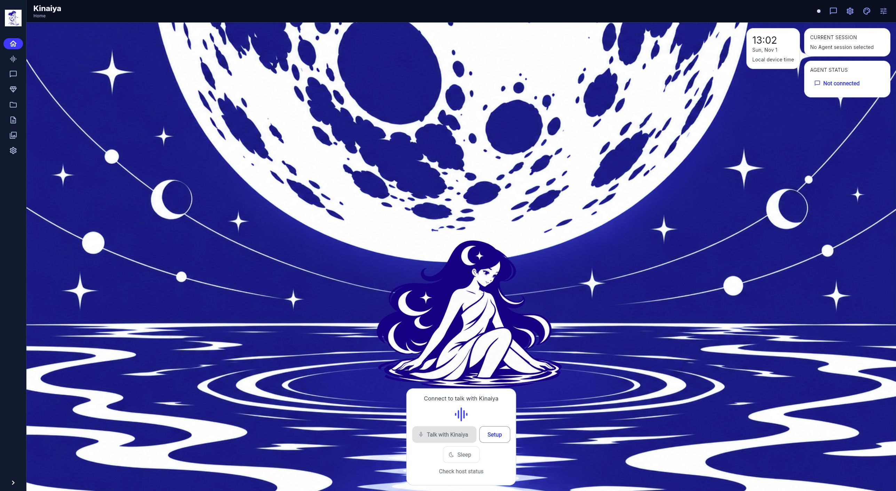
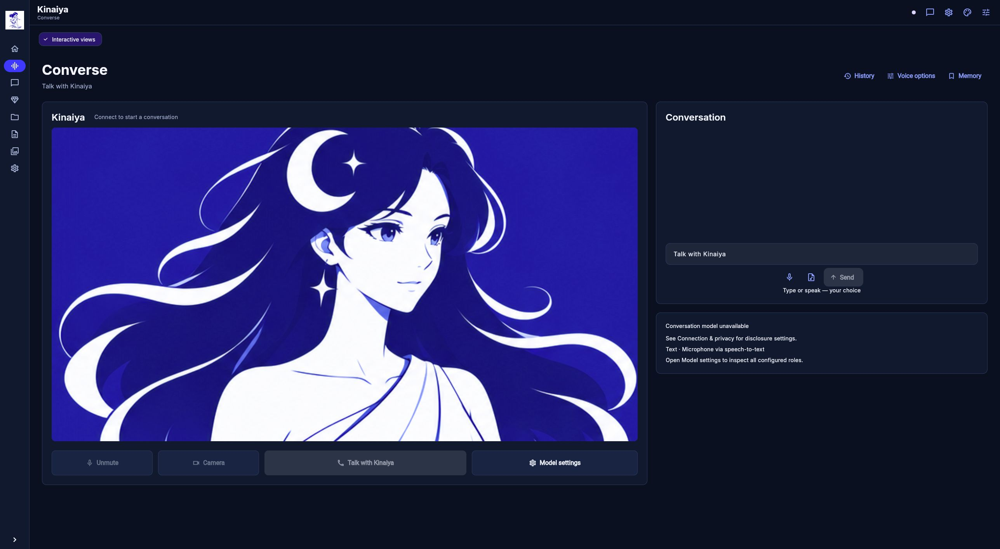
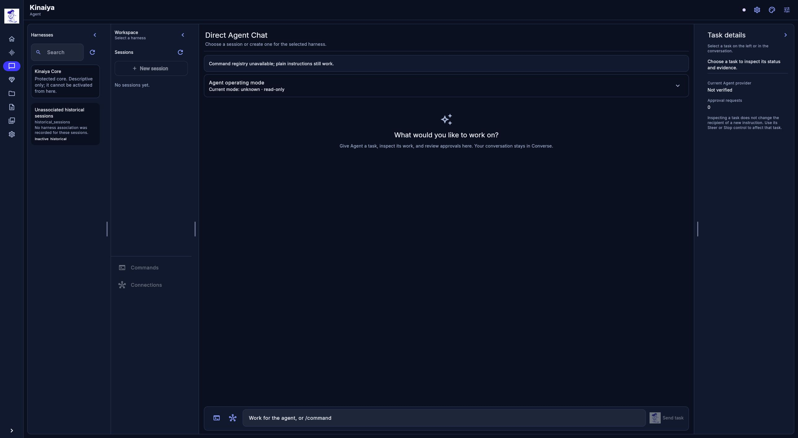

# Kinaiya

**A companion to talk to. An agent to get things done.**

Kinaiya brings a personal AI character and an independent work agent into one workspace. Talk things through with **Converse**, give **Agent** a task, and keep conversation and work side by side—with the models and providers you choose.

Converse is optional. Agent stays available for coding, research, files, and other authorized tool work when voice is off.

[See the interface](#see-the-interface) · [Why Kinaiya](#why-kinaiya) · [Get started](#get-started) · [Technical details](#technical-details) · [Mathematics](#mathematical-foundations) · [Roadmap](Roadmap.md)

## See the interface

| Home | Converse |
| --- | --- |
| <a href="assets/screenshots/2026-11-01-ui-refresh/home.jpg"></a> | <a href="assets/screenshots/2026-11-01-ui-refresh/converse.jpg"></a> |
| **Agent workspace** | **Options** |
| <a href="assets/screenshots/2026-11-01-ui-refresh/agent.jpg"></a> | <a href="assets/screenshots/2026-11-01-ui-refresh/options.jpg"></a> |

*Actual application captures, November 1, 2026, with services disconnected and an empty Agent workspace. Select an image to open the complete capture.*

See the [application gallery and capture provenance](assets/screenshots/README.md) for more views and earlier captures.

Explore the [editable interface designs](assets/penpot/README.md) for Converse, Agent, Options, and intelligent views. Those boards are design references with illustrative content.

## Why Kinaiya

- **Conversation alongside useful work.** Talk or type with Converse, then work directly with Agent or route a relevant conversation request through Decisions. Task progress, approvals, and results stay visible in the Agent workspace.

- **A character you can make your own.** Import a character pack, choose its colors, and adjust captions, motion, and speech-mouth preferences. Converse keeps personality and dialogue separate from Agent's work.

- **Models for different jobs.** Choose supported local or cloud providers for Agent, Converse, routing, speech recognition, and speech output. Configure Agent models for individual harnesses and auxiliary reasoning tasks through Options.

- **A place for ongoing projects.** Organize Agent sessions into Projects, revisit task history, and find recorded generated outputs in the Documents and Media libraries with their source sessions.

- **Results you can explore.** Experimental intelligent views bring structured results, such as tables and diagrams, into the conversation. Pinned views can be reopened, with readable fallbacks where needed.

- **Tools with visible controls.** Work with supported skills, MCP connections, and reviewed plugins. Inspect available capabilities, model context, and approvals from the Options workspace.

## Get started

Kinaiya currently uses a Linux development host and a Flutter web interface. Start with the [host setup](#run-the-host), then follow the [web client guide](apps/kinaiya_flutter/README.md) and [Converse setup](docs/converse-setup.md) for the interfaces you want to use. Choose a supported provider configuration before starting model-backed work.

A polished clean-machine installer is not yet available. The detailed commands, provider requirements, and configuration boundaries are retained below.

## Current stage

**Experimental and actively developed.** Independent Agent work, the conversation infrastructure, character customization, configuration controls, and bounded extension workflows are implemented. Voice quality and interruption recovery, broader provider qualification, mobile calling, and distribution remain active work.

Adaptive-harness research explores how Agent can create executable extensions, evaluate them against a fixed baseline, and use reviewed promotion or rollback. General autonomous improvement has not been demonstrated. The [implementation ledger](docs/implementation-status.md) distinguishes implemented capabilities, measured experiments, and remaining acceptance gates.

---

## Technical details

The architecture, implementation notes, operating constraints, setup instructions, verification commands, and complete mathematical foundations remain in this README. The product introduction above does not replace them.

**A local-first conversational platform with an independent work agent.**

Kinaiya pairs a personable, real-time voice experience with an agent that can do useful work on its own. The design keeps conversation, routing, and task execution in separate components, then lets them share relevant context through a bounded, inspectable transcript.

## Product scope

- **Converse** owns the character, conversational behavior, voice input and output, interruptions, and the user-facing experience.
- **Agent** handles direct chat and authorized work such as repository analysis, coding, research, and document tasks. It remains useful when Converse is off.
- **Decisions** classifies and routes relevant requests between components. It does not speak as the character or grant permission.
- **Shared transcript** gives components a common record. Agent retrieves the context it needs instead of receiving the entire conversation on every turn.
- **Adaptive harness research** explores how Agent can generate and evaluate task- and model-specific executable extensions while protecting the trusted core, permissions, and evaluator.

The long-term product scope also includes resource-aware operation, provider choice, durable work, skills and MCP tools, mobile calling, and optional intelligent UI. Those are planned capabilities, not promises that every feature will ship in one release.

The [Roadmap 0.3.2](Roadmap.md) retains the October 30 reconciliation, October 31 model-choice/performance clarification and November 1 optional Omni Converse paths. The [implementation and acceptance ledger](docs/implementation-status.md) distinguishes implemented slices, experiments, unverified gates and planned work at source `f92f6d1`; it is the consolidated progress record. Partial resource/ecosystem/mobile foundations do not establish completion of the full product scope above.


## Status

An initial Linux research implementation now includes versioned contracts, authenticated persistent transcript storage, independent Agent and Converse services, asynchronous routing, scoped tools/approvals, a functional Flutter web client, and real-provider integration tests. The implementation is experimental. The full roadmap, all retained voice backends, native mobile calling and production hardening remain open development gates.

Live listening now uses retained transcript windows with separate Decisions outputs
for conversation timing and Agent routing. It can hold a prepared reply for a
speaking opening, preserve speech during backchannels, steer/cancel work, and
queue follow-ups until a native task boundary. See the
[streaming-window design and verification limits](docs/adr/0019-streaming-window-control.md).

Unfinished live speech requires owner review before file writes, shell commands,
or MCP calls, including with broad tool grants or YOLO. Agent Chat shows current
approvals across conversation sessions. Silence alone does not commit speech;
see the [source-authority boundary](docs/adr/0020-streaming-source-authority.md).

An opt-in [typed Laya Decisions adapter](docs/adr/0021-laya-decisions.md) supports
local Jev inference in a separate process, with native source/task bindings and
explicit classification refusals. The optional [verified local worker](docs/laya-worker.md)
loads a private snapshot of pinned model files and checks artifact identity on
every response without inventing a Hub revision. Base-model and supervised synthetic results
remain research evidence; Laya is not yet promoted as the reference default.

See [Roadmap.md](./Roadmap.md) for architecture, milestones, acceptance criteria, risks, and implementation references.

## Project principles

- Keep the voice experience and work agent independently usable.
- Make permissions and action results explicit; model output cannot create user authorization.
- Preserve provider portability and clearly distinguish verified integrations from targets.
- Measure the adaptive-harness claim against pinned baselines and safe rollback behavior.
- Keep prototype evidence, recorded demos, fixtures, and implemented functionality clearly labeled.

## Run the host

Use Python 3.11+ in a virtual environment:

```bash
python -m pip install -r requirements-dev.lock
python -m pip install --no-deps -e .
kinaiya init
# Configure data/config.json with your chosen providers and disclosure policy.
kinaiya --workspace workspace serve all
```

Services bind loopback: session 8760, Agent 8761, Converse 8762 and Decisions 8763.
`kinaiya serve agent` and `kinaiya serve converse` also start independently alongside
storage. `kinaiya agent "Write a small file"` connects directly to Agent. Unapproved
writes and shell calls wait for an action-specific owner approval. The worker
workspace must be separate from core, evaluation, settings and credential directories.

Agent [file-write arguments](docs/adr/0043-write-file-arguments.md) use explicit path
and content strings and are checked before approval and dispatch. Optional legacy
revision metadata is validated against the native task revision and stays bound
to the exact approval digest. Malformed writes produce an unsuccessful observation
for the bounded task loop.

The [Flutter web client](apps/kinaiya_flutter/README.md) provides Character View,
voice recording/playback and independent Agent Chat. Its [design and browser evidence](docs/adr/0005-flutter-voice-client.md)
describe the tested synthetic voice-to-file flow and Agent operation while Converse
was unloaded. Native voice and the remaining M5 gates are unfinished.

Agent Chat's [operating-mode control](docs/agent-control-api.md) reads and changes
native Off/on-demand independently of Converse. Off refuses new tasks and steering;
already accepted work may finish under its existing authorization, and Stop and
approvals remain available. Autonomous is unavailable pending a standing-work producer.

The owner app's [Options workspace](docs/adr/0077-options-workspace-and-harness-models.md)
uses persistent section navigation and embeds the existing appearance, voice,
memory, connection and MCP editors. Models, Providers and Harness Customization
are separate pages. Native revision-bound Agent defaults and per-harness model/
reasoning overrides affect new tasks; accepted tasks retain their provider and
inspectable model pin. The [owner API](docs/agent-options-api.md) persists settings
and receipts without placing active provider credentials in model preferences.
New model saves bind the observed backend and writer generation;
[exact uncertain-save recovery](docs/adr/0088-bound-model-settings-writes.md)
keeps the original owner/backend scope across reconnects and does not reapply a
historical preference. Older unbound requests are exact-replay-only.
Execution preferences use their own [bound recovery](docs/adr/0090-bound-execution-settings-writes.md)
and database identity, with exact historical receipts and a shared bounded
settings transport pool. Runtime version 1.0 retains its existing first-write
and replay behavior; new UI writes require observed runtime authority.
The [Providers catalog](docs/adr/0086-owner-provider-catalog.md) adds native
profile and protected credential-generation forms. [Agent model selection](docs/adr/0089-agent-catalog-models.md)
captures exact saved versions in fresh task-owned primary/auxiliary adapters;
saving a provider profile alone does not select it. Independent
[Converse text model settings](docs/adr/0091-converse-text-model-settings.md)
select an eligible exact catalog generation while actual Converse operations
and cleanup are settled. Independent
[Decisions](docs/adr/0098-independent-decisions-model-selection.md),
[STT](docs/adr/0099-independent-stt-model-settings.md), and
[TTS](docs/adr/0101-independent-tts-model-settings.md) editors now select supported
host or eligible catalog configurations through their own native owners.
These supersede the earlier host-managed-only editing limitation; configuration
does not establish model readiness. Local voice/profile reconfiguration, broader
provider support and the runtime/concurrency acceptance described in the ADRs
remain separate work.
Global and per-harness [auxiliary text models](docs/adr/0082-task-pinned-auxiliary-models.md)
support explicit analysis, compression, title, delegated reasoning and harness
design side calls. Native task pins, measured admission and disclosure remain
authoritative; these calls cannot execute tools or grant permissions.
The [options catalog](docs/options.md) distinguishes implemented, host-managed
and planned controls. Stable semantics use the [supplied Penpot presentation](docs/adr/0054-penpot-owner-interface.md).
The [updated Home and optional Converse design](docs/adr/0059-home-and-optional-converse.md)
shares one live conversation owner: Home keeps the seated water scene, while the
optional interaction view adds close-up artwork, transcript and composer. Home's
mascot/Setup opens model declarations and local view visibility. Text model choice
lives in Options / Models; camera/direct-audio input remains unavailable in the production app. Owner
Projects group Agent sessions; Generated Documents and Generated Media list
native output receipts with time, type and source session. These libraries do
not scan workspace folders or grant file access.
The [synthetic multimodal qualification](docs/adr/0083-synthetic-multimodal-qualification.md)
records local LFM3/Gemma/d1 and Meta API observations, exact inputs and failed
checks. Those probes do not enable camera capture or establish production
multimodal readiness; [the remaining gates](https://github.com/rgoza1996/Kinaiya/issues/204)
include actual owner-armed transport and a labelled routing/quality matrix.
The [setup bubbles](docs/adr/0063-floating-setup-bubbles.md) start in fresh random
positions and drift slowly. Hover/focus holds only the affected bubble; dragging
and bounded flinging, bubble-to-modal growth, a floating Close control and
empty-space dismissal honor motion preferences and preserve voice Stop controls.
The [Decisions owner window](docs/adr/0066-decisions-owner-window.md) now reads
actual provider-bound captures through the [private inspection API](docs/decisions-trace-api.md):
literal submitted scripts, raw/validated outputs, historical identities and
bounded session/date filters. Missing historical capture stays unavailable;
direct Agent observations explicitly show no Decisions inference. This inspection
slice does not establish overall routing/model-quality acceptance.

Agent has [two independently collapsible sidebars](docs/adr/0065-agent-sidebars.md):
Harnesses and the selected harness's Workspace/sessions. Native eligibility and
immutable session/task pins govern selection; a host with no configured selector
registry exposes Seed Agent and legacy unassociated sessions remain unassociated. Current generated
entries are bounded context selectors, not complete generated Agent runtimes.
The close-up's [mouth motion](docs/adr/0064-speech-mouth-playback.md) follows
actual decoded/playback-clock audio; optional visemes require real timing data.
Newer design-chat hair/mole/highlight reference artwork remains pending pack integration.

An experimental [Converse memory core](docs/adr/0047-converse-memory-core.md)
is installed only with `kinaiya serve session --converse-memory` (or the same
switch on `serve all`). Its owner-only API starts each current Converse namespace
disabled. Explicitly enabled namespaces accept local owner-curated, transcript-pinned
claims and hard dependencies, reconcile corrections and contradictions, retrieve
complete bounded dependency sets, and forget retained content. Disabling use and
deleting data are separate controls. Agent and Decisions do not use this DAG.

The first [selected recall runtime](docs/adr/0051-converse-selected-recall.md)
adds owner-only Converse `POST /v1/memory/state` and `/v1/memory/use` controls.
Runtime use starts off after every restart and is separate from the persisted
namespace enable/retention setting. The owner selects existing note IDs; a local
provider must measure the complete proposed prompt before either typed or live
window generation uses the complete dependency set. Unsupported counting,
unavailable memory or insufficient context omits recall. Provenance checks exclude
old memory-derived assistant history after off, replacement or invalidation while
keeping the authoritative transcript inspectable. In-flight work may remain
pending after off; cancellation does not prove a journal write failed.
The experimental owner [Memory dialog](docs/adr/0052-converse-memory-owner-ui.md)
in Character View browses and inspects existing notes, controls saved access,
and explicitly selects up to eight active notes for use or stops using them.
Opening it only reads the current scope. The owner-only Session catalog is
complete and bounded; disabled listing does not reconcile sources or write data.
Unconfirmed changes retain bounded RAM latches across dialog close/reopen and
same-endpoint reconnect; unchanged refresh values cannot settle an old write.
Namespace access and runtime use remain separate. The owner can now
[create a transcript-pinned note, create a revised note and explicitly forget a note](docs/adr/0085-converse-note-editor.md).
Revision creates another immutable note; forgetting the original is a separate
action. Exact historical receipts help reconcile uncertain saves without
recreating erased content. Automatic extraction, relevance ranking and improved
human recall remain unfinished.

Optional local skill controls are enabled with `"skills": {"enabled": true}` in
the owner configuration. `/skills list`, `/skills install <local-path>`, and
`/skills enable <qualified-id>` manage packages without inference; `/skill
<qualified-id> [request]` starts normal Agent work with selected, pinned
instructions. Packages default to local-only disclosure. The [Agent skill
boundary](docs/adr/0010-agent-skills.md) records the tested workflow and the
remaining registry, upstream compatibility and execution-adapter work.

Optional [MCP connection management](docs/adr/0017-mcp-management.md) is enabled by
`"mcp":{"enabled":true}` after installing the ecosystem extra. Agent `/mcp`
commands and its **MCP connections** settings configure disabled profiles, test
connections, enable, reconnect, disable and remove servers without inference.
Configuration changes use explicit task boundaries and durable request identities;
stop/status and permission revocation remain available. Only reviewed environment
secret references are accepted. OAuth and complete MCP/skill ecosystem conformance
remain open.

Recovered paused work supports owner [native retirement](docs/adr/0018-recovered-task-retirement.md)
after a session reset. Its durable receipt keeps the original task identity and
records unreconciled effects without copying old execution context into the new
epoch. Unacknowledged retirement stays paused until explicitly reconciled; MCP
management remains blocked while any work is nonterminal.

Initial Agent submissions use [native admission](docs/adr/0087-agent-submit-admission.md)
to commit the journal entry and its logical idempotency slot together. An
unconfirmed acknowledgment stays paused and returns an explicit HTTP503; a RAM
entry alone cannot establish acceptance. Exact retries reconcile the original
native identity and model pins without starting another worker. Only the direct
validated creation receipt can start work after fresh authority checks; a retained
or recovered receipt grants no execution. Upgrade requires quiescing old Agent
and Session writers because generic initial-submit append is no longer accepted.
This does not provide exactly-once third-party tool effects or automatic resume.

An optional [isolated compute-plugin host](docs/adr/0016-compute-plugins.md) can
retain ordinary Python/JSON algorithms independently of the LLM that authored
them. Owner-held acceptance suites and reviewed promotion gate activation;
`/plugins` controls and direct owner invocation require no inference. Agent can
discover and call approved versions with task pins and native result receipts.
The [public CSV acquisition evidence](evaluation/evidence/compute-plugins-2026-10-27.json)
records real source generation, isolated execution, rejected updates and rollback.
General dependency installation, hooks, foreign plugin adapters and full autonomous
capability acquisition remain open.

Optional voice runs in a separate Python with the `voice` extra and preinstalled
Kokoro/Whisper weights: `python -m packages.providers.voice_worker`. Model downloads
are disabled by default; a clean-machine model installer is still a roadmap task.
An explicit [GPU voice profile](docs/adr/0056-explicit-gpu-converse.md) selects
pinned OpenAI Whisper tiny/tiny.en and Kokoro on CUDA or AMD ROCm, verifies loaded
parameters and buffers, and refuses CPU fallback. It supports a local GPU dialogue
provider with thinking disabled. Combined VRAM and native execution evidence are
tracked in [#132](https://github.com/rgoza1996/Kinaiya/issues/132); a development-GPU
measurement does not establish constrained 8 GB hardware acceptance.
An opt-in [managed Whistle CPU STT profile](docs/adr/0034-managed-whistle-cpu-stt.md)
selects transcription independently of TTS, using pinned local artifacts and a
separate owned native process. It supports bounded PCM WAV slices with process
cancellation and recovery. Persistent incremental STT and real-time acceptance
remain open.
The optional [native incremental Whistle binding](docs/adr/0036-incremental-whistle-stt.md)
has separately passed a local engine append/flush/cancel/recovery experiment.
Its measured two-CPU profile is too slow for realtime speech; production
streaming transport and client integration remain unfinished.
An opt-in [Supertonic 3 CPU backend](docs/adr/0027-retained-supertonic.md) also
synthesizes through the same speech bridge using pinned, verified local assets.
Its output is buffered before transport; the small synthetic screen does not meet
the roadmap's warm-onset target or establish physical audible latency. The experimental
[VibeVoice Realtime 0.5B CPU adapter](docs/adr/0029-vibevoice-transformers5.md) emits native
waveform chunks with request-owned cancellation. Its explicit Transformers 5.21
runtime derivative preserves upstream and patched source provenance. A nine-reply
synthetic screen observed median first PCM at 226 ms, first non-silent frame at
2.88 seconds, and RTF 2.60; it does not sustain realtime speech. The newer
installed-environment audit lists no vulnerabilities for covered packages and
explicitly skips the custom runtime and direct CPU Torch wheel. Exact evidence,
research-use qualifications and remaining acceptance gates are documented in the
ADR. This is an experimental profile with no default promotion or physical
audibility claim. [Ming 3 Tiny](https://github.com/rgoza1996/Kinaiya/issues/72)
remains a retained candidate with an unconfigured backend; full M2 acceptance
remains open.

An opt-in [CPU voice resource coordinator](docs/adr/0013-resource-handoff.md)
can own that worker, verify process release for an explicit local-work handoff,
and restore voice when a bound Agent task finishes. Optional
[managed Laya residency](docs/adr/0022-managed-laya-resources.md) adds pinned
worker ownership, AMD driver telemetry and explicit GPU headroom admission.
`/resources` controls stay in Agent Chat; approvals remain usable while Converse
is paused. General GPU scheduling, other local text-model unloading and complete
M6 reliability remain open. [Durable owner intent](docs/adr/0023-converse-owner-intent.md)
keeps acknowledged Converse-off choices effective through restoration and restarts.

Experimental [managed native text](docs/adr/0040-managed-native-text.md) adds an
opt-in GGUF Converse worker with pinned offline inputs, native SSE streaming and
owned cancellation/release barriers. It shares lifecycle ownership with the
existing Qwen profile while preserving each protocol. Initial implementation
and synthetic verification are CPU-only; actual runtime/model acceptance,
GPU policy, dialogue quality and the combined 8 GB voice-profile target remain
separate gates. It is not a reference default.

Production Converse [history budgeting](docs/adr/0057-converse-context-window-budget.md)
uses the active model's complete formatted prompt count and reserved output space.
Semantic native pages preserve corrections and playback qualifications while
routing traffic consumes no dialogue allowance. It retains whole recent messages
that fit, rather than eight live or twelve typed entries. The local native
`lmstudio` provider uses the exact already-loaded instance for counting and
generation, without JIT loading. Providers lacking exact counting visibly refuse
this host path; a compatible HTTP endpoint alone is insufficient. Embedded
runtime compatibility remains separately identified in health. Conversation
quality and physical latency still require human testing.

Agent's [complete-context admission](docs/adr/0075-complete-agent-context.md)
preserves complete native file observations and selects whole action/result
exchanges using an exact count of the complete proposed request. The trusted
instructions, current objective/revision and newest exchange remain protected.
Meta Agent profiles need an explicitly verified `context_tokens` value and the
native count endpoint; unsupported complete-count providers refuse visibly.
Generic compatible HTTP alone does not establish this capability. Every count
and generation also needs a fresh native source admission. These mechanisms
do not establish general Agent task reliability or complete the M1 gate.

An optional [whole-chat prompt measurement](docs/adr/0050-converse-prompt-measurement.md)
uses only an already resident managed GGUF worker, without generating a reply or
loading a model. Its result binds the complete chat request and protected profile
and accounts for reserved output when checking context capacity. Unsupported
counting refuses without a guessed estimate. The installed fork's count route
has not been exercised; synthetic transport tests do not establish compatibility.
Selected memory recall depends on this optional capability; an unsupported
installed counter leaves ordinary dialogue available without recalled content.

A bounded [runtime-state publication guard](docs/adr/0042-negative-runtime-state-publication.md)
also substitutes uncertainty for selected unsupported negative Agent/task claims
in generated Converse chunks. It preserves the existing native outcome evidence
path. Its finite English matching does not qualify a model or establish general
dialogue truthfulness.

Provider keys belong in secret references/environment variables. Development Meta
Contributor profiles are for public code and synthetic inputs only. The live test
requires an explicit paid-inference flag and a budget proxy; ordinary CI is offline
with respect to inference. See [integration evidence and limits](docs/adr/0002-verified-integration-slice.md)
and the [threat model](docs/security/threat-model.md).

An opt-in [OpenRouter Kokoro TTS selection](docs/adr/0062-explicit-openrouter-tts.md)
provides cloud speech output independently of dialogue and STT. It uses its own
protected credential and bounded admission ledger, authorizes each persisted
reply's disclosure scope, and retains native interruption/cleanup ownership.
Selecting it introduces no local TTS fallback or managed-worker lifecycle change.

[Native disclosure scopes](docs/adr/0037-typed-disclosure-scopes.md) default
typed input, tasks and legacy unscoped history to local-only. Public/synthetic
and private-cloud input require explicit grants; Contributor accepts only the
public/synthetic grant. Drafts and recordings keep their capture-time scope
when providers change. CLI cloud work must specify its input grant explicitly,
for example `kinaiya --content-scope public_synthetic agent "Read the synthetic fixture"`.

```bash
ruff check .
ruff format --check .
pytest -m 'not live' -q
```

## Mathematical foundations

Kinaiya combines discrete-state coordination, cryptographic integrity, budget-constrained execution, streaming inference, and adaptive-harness research. The equations below distinguish **what the experimental code enforces** from **what the roadmap proposes to evaluate**. Proposed formulations illustrate possible research methods; they are **not implemented algorithms or measured performance claims**.

### 1. Decisions: risk-aware conversational routing

**Status:** A four-way asynchronous classifier and routing worker exist; calibrated probabilistic decision theory is proposed.

Decisions chooses among ignore, queue, steer, and interrupt. A possible risk-sensitive decision rule is:

$$
\mathcal{A}=\{\mathrm{ignore},\mathrm{queue},\mathrm{steer},\mathrm{interrupt}\},
\qquad
a_t^*=\arg\min_{a\in\mathcal A}\sum_{y\in\mathcal A}
P_\theta(y\mid x_t,H_t,z_t)L(a,y).
$$

Here $x_t$ is the current message, $H_t$ is relevant conversation history, $z_t$ is task state, and $L(a,y)$ penalizes choosing route $a$ when the appropriate route is $y$. Missing a cancellation may deserve a larger penalty than an unnecessary interruption. **This loss-based decision rule is a proposed formulation**, not a claim about the current classifier or calibration; model confidence is not automatically a probability. Routing never grants tool permissions.

[Decisions runtime](services/decisions/runtime.py) · [Routing design](Roadmap.md#6-asynchronous-decisions)

### 2. Shared transcript: context selection under a token budget

**Status:** The persistent journal and bounded retrieval exist; optimized snippet selection is proposed for the first self-building harness experiment.

Selecting relevant snippets can be modeled as a 0–1 knapsack problem:

$$
\begin{aligned}
\max_{\mathbf{s}}\quad &\sum_{i=1}^{n}v_i s_i\\
\text{subject to}\quad &\sum_{i=1}^{n}c_i s_i\le B,\qquad s_i\in\{0,1\}.
\end{aligned}
$$

$v_i$ is a snippet's estimated utility, $c_i$ its token cost, $B$ the token budget, and $s_i$ whether to include it. This **illustrates the planned context-selection experiment**; the existing journal enforces limits and retrieval filters but does not solve this optimization problem.

[Journal implementation](services/session/store.py) · [Harness experiment](Roadmap.md#123-first-executable-experiment)

### 3. Event consistency: ordering, revisions, and authorization

**Status:** Implemented invariants and cryptographic action binding.

The journal assigns monotonically increasing sequence numbers, consumer cursors cannot retreat, and applied task steering increments the objective revision:

$$
s_{i+1}>s_i,\qquad c_{t+1}\ge c_t,\qquad r_{\mathrm{new}}=r_{\mathrm{old}}+1.
$$

An action-specific approval is tied to the canonicalized tool name, arguments, and objective revision:

$$
h=\mathrm{SHA256}(\mathrm{CanonicalJSON}(a,\theta_a,r)).
$$

The supervisor accepts it only when its digest and revision match, it has not expired, and it has not been consumed. Hashing helps bind authorization to a particular action; **it does not by itself authorize the action or make the system infallible**.

[Journal implementation](services/session/store.py) · [Policy and approvals](core/policy/__init__.py)

### 4. API economics: conservative admission control

**Status:** Implemented in a development-only Meta API budget proxy; not live provider billing.

For reported input tokens $I$, output tokens $O$, and cached input tokens $K$, the proxy preserves an ordinary-Spark comparison and a Contributor estimate using its configured dollar-per-million-token constants:

$$
\widehat C_{\mathrm{ordinary\ comparison}}=\frac{1.25I+4.25O}{10^6},
\qquad
\widehat C_{\mathrm{contributor}}=
\frac{0.10(I-K)+0.002K+0.20O}{10^6}.
$$

For settled responses with validated usage and exact requested/resolved Contributor identity, admission uses twice the cache-aware Contributor estimate. The earlier uncached admission estimate remains a separate audit counter. Unexplained legacy charges, incomplete usage and uncertain reservations are preserved; real reported billing remains a floor. Each future text request still reserves the full uncached catalog context plus bounded output at twice Contributor rates. Text retains a $22 sublimit and buffered voice a $3 sublimit. All settled estimates, outstanding reservations and the next reservation must fit the retained combined ceiling, at most $25. `--limit-usd 10` lowers that existing ceiling without resetting earlier spend or reservations; a later argument cannot raise it.

$$
\max(\widehat C_{\mathrm{settled}},C_{\mathrm{billing}})+C_{\mathrm{reserved}}+C_{\mathrm{next}}\le C_{\mathrm{owner\ ceiling}}.
$$

The [Meta pricing page](https://dev.meta.ai/docs/pricing-rate-limits) was verified on October 31, 2026. These calculations remain estimates, **not provider invoices**. Hosted text tools with additional fees are refused; Muse's local function tools remain available, including bounded namespace groups emitted by the CLI. The validator examines tool declarations without interpreting function parameter schemas as tools. No cache discount is assumed before a response reports it. Optional single-image SAM/Muse Image smoke routes have a separate $0.10 sublimit and are disabled by default; see [bounded testing and accounting](docs/meta-budget-tests.md).

[Budget proxy](scripts/muse_budget_proxy.py)

### 5. Streaming conversation: latency and real-time factor

**Status:** Experimental Converse streaming/chunking exists; the performance goals and broad TTS comparison are research targets.

A purely sequential speech pipeline has approximate latency

$$
T_{\mathrm{sequential}}=T_{\mathrm{STT}}+T_{\mathrm{LLM}}+T_{\mathrm{TTS}}.
$$

Overlapping pipeline stages can reduce perceived response time. The critical-path bound for an idealized dependency graph $G$ is

$$
T_{\mathrm{pipeline}}\ge
\max_{p\in\mathcal P(G)}\sum_{v\in p}t_v.
$$

For synthesis, real-time factor is

$$
\mathrm{RTF}=\frac{T_{\mathrm{synthesis}}}{T_{\mathrm{generated\ audio}}}.
$$

RTF below 1 means synthesis is faster than audio duration. The roadmap proposes warm audible TTS onset below **250 ms median / 500 ms p95**, end-of-speech to audible reply below **1 s median / 2 s p95**, and sustained **RTF < 1** (stretch **RTF < 0.3**). These are **unverified reference-profile targets**, not achieved measurements. Overlapping stages still incur buffering, contention, and scheduling overhead.

[Converse runtime](services/converse/runtime.py) · [Measurement plan](Roadmap.md#252-voice-measurements)

### 6. Local inference: GPU resource admission

**Status:** Explicit CPU voice/AMD Laya handoffs and measured headroom checks exist.
The general scheduling formulation below remains proposed.

Before loading several local workers, a resource manager could enforce a capacity constraint:

$$
M_{\mathrm{weights}}+M_{\mathrm{KV}}+M_{\mathrm{buffers}}+
M_{\mathrm{renderer}}+M_{\mathrm{headroom}}\le M_{\mathrm{VRAM}}.
$$

This is a first-order memory-accounting model, not a complete measure of feasibility: latency contention, fragmented/reserved allocations, and unloading behavior also matter. The intended policies allow queueing, deliberate worker handoff, or **user-authorized** cloud inference—not silent cloud fallback.

[Resource policy and handoff](Roadmap.md#14-inference-providers-and-resource-management)

### 7. Self-building harnesses: controlled optimization and evaluation

**Status:** The bounded seed Agent, isolated executable context selectors, protected evaluation, owner-reviewed promotion controls and rollback are implemented experimentally. The initial 12-case screening study rejected the generated candidate; no improvement was demonstrated. Paired Agent-task optimization and the formulations below remain research milestones.

With fixed target model, tasks, tools, and budgets, compare baseline harness $H_0$ and generated candidate $H_1$ on the same $n$ tasks. For independently evaluated task quality $Q_i$, a paired improvement estimate is

$$
\widehat{\Delta}=\frac{1}{n}\sum_{i=1}^{n}
\bigl[Q_i(H_1)-Q_i(H_0)\bigr],
\qquad
\mathrm{SE}(\widehat{\Delta})=\frac{s_d}{\sqrt n}.
$$

Here $s_d$ is the sample standard deviation of paired task-score differences. Repeated runs, held-out tasks, uncertainty reporting, and controlled baselines are needed before claiming an improvement. If a candidate saves $C_0-C_1>0$ per task after adaptation costing $C_{\mathrm{adapt}}$, a simple break-even estimate is

$$
N_{\mathrm{break\text{-}even}}=
\frac{C_{\mathrm{adapt}}}{C_0-C_1}.
$$

Most importantly, better scores must **never** compensate for weakened permissions, modified objectives, forged evidence, or exceeded budgets. The planned research objective is *constrained*, not an unconstrained reward maximization:

$$
\begin{aligned}
\max_{H\in\mathcal H}\quad&
\mathbb E_{x\sim\mathcal D}[Q(H,x)]\\
\text{subject to}\quad&
\mathrm{Safe}(H)=1,\quad\mathrm{Integrity}(H)=1,\\
&C_{\mathrm{adapt}}(H)\le B_{\mathrm{adapt}},\quad
C_{\mathrm{run}}(H)\le B_{\mathrm{run}}.
\end{aligned}
$$

These are **proposed evaluation formulations**, not a shipped optimization algorithm or proof of safety.

[Seed harness](harnesses/seed/__init__.py) · [Evaluation and promotion policy](Roadmap.md#12-harness-evaluation-and-promotion) · [Research measurements](Roadmap.md#254-harness-measurements)


## Hackathon target

The planned demonstration is a focused slice through the larger roadmap:

1. Real voice conversation with interruption support and an original, replaceable character.
2. A real routed request that uses shared conversation context.
3. Agent completes useful work and reports evidence of the result.
4. Direct Agent Chat remains available while Converse is off.
5. Agent generates an executable harness extension, evaluates it against a pinned baseline, and demonstrates safe rejection, promotion, or rollback.
6. At least one verified Meta integration is exercised if the event requirements, account access, and applicable terms allow it.

Meta is a target integration, not a product dependency. Model and API availability must be verified during implementation; the core stays provider-configurable. A Meta-generated character variant is a stretch demonstration, not a requirement on the voice-response path.
