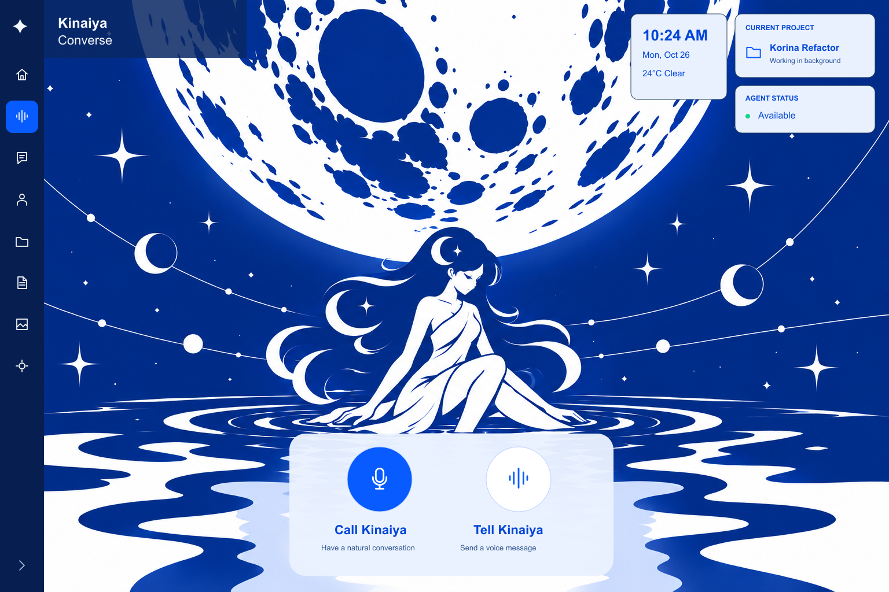
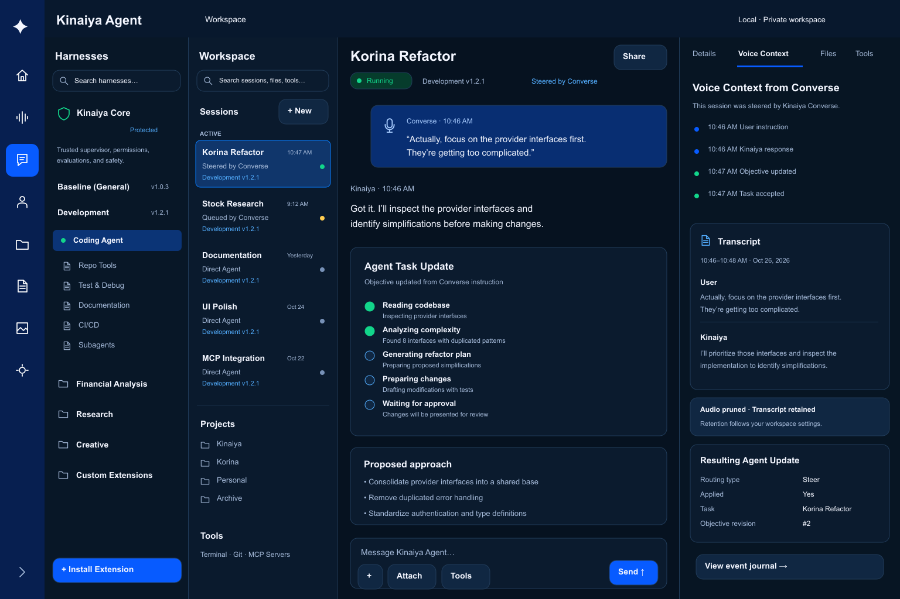

# Kinaiya Penpot design

This folder contains the editable [Converse and Agent Penpot file](Kinaiya-Converse-Agent.penpot).
It is a design draft based on the [Converse](../UIUX%20Concept/kinaiya-converse-moonlit-concept.png)
and [Agent](../UIUX%20Concept/kinaiya-agent-workspace-concept.png) concepts and an
unfinished Figma export. It explores intended interactions; it is not a claim
that every pictured feature is implemented. The project, conversation, file,
media, and status examples are illustrative.

These early desktop exports provide a quick overview; the Penpot file is the
editable source and contains many more screens:

| Converse home | Agent workspace |
| --- | --- |
|  |  |

## Open and edit

1. Install [Git LFS](https://git-lfs.com/) and run `git lfs install`, then clone
   this repository. In an existing checkout, run `git lfs pull`. The Penpot file
   is stored in Git LFS because it exceeds GitHub's regular file-size limit.
   GitHub source ZIP downloads may contain an LFS pointer instead of the design.
2. Open Penpot, choose **Import file** in the dashboard, and select
   `assets/penpot/Kinaiya-Converse-Agent.penpot` from the checkout.
3. Open the imported file and choose a page in the left sidebar. Select layers to
   edit them; use the **Prototype** tab and **View mode** to inspect linked flows.

The current October 30 consolidated **Kinaiya — Master design** export contains
14 pages and 172 top-level boards. Its SHA256 is
`6e35d43f04808bb793542c888e740c9b26692e3967e7985c508d9306d534e669`.
The first page, **00 · Home & Converse · Updated**, contains 94 boards, including
the Model/Reasoning/Inputs/Speech/Decisions bubbles, Decisions trace screens,
and parallel fade/instant prototype routes. The Home, optional Converse and
sleeping illustrations reflect the latest character design. Prototype choices are illustrative;
the app saves real interface-transition preferences independently of Penpot.
The app implementation follows [ADR 0059](../../docs/adr/0059-home-and-optional-converse.md);
the updated bubbles, transitions and speech behavior follow
[ADR 0060](../../docs/adr/0060-converse-handoffs-and-motion.md).
Unsupported model switching, camera and library controls are not working runtime
features merely because they appear in this prototype.

Text, interface shapes,
controls, and icons are editable Penpot layers. The moonlit illustration and
mascot expression references are replaceable raster images, not editable vector
artwork. The expression boards are static design references, not a playable
sprite animation or a demonstration of live TTS synchronization.

## Page guide

| Page | Purpose and key boards | Design status |
| --- | --- | --- |
| **00 · Home & Converse · Updated** | Moonlit Home, owner-off sleeping state, optional close-up Converse, model/conversation setup, Decisions trace screens, listening and connected sidebar destinations. | Current owner direction. Illustrative models, tasks and library contents remain examples. |
| **00 · Foundations** | Colors, typography and example controls used as a starting point for the design system. | Draft foundation; not a complete component library. |
| **01 · Converse** | Moonlit home, listening state, and an Options copy for the Home flow. Call and end-conversation links demonstrate the voice entry flow. | Concept-based draft. The Home and gear icons link between the local Home and Options boards. |
| **02 · Agent** | Agent workspace while a task runs and a review/approval state, based on the Agent concept. | Concept-based draft; task details and outcomes are examples. |
| **03 · Converse flows** | Voice-message review, text conversation, history, voice options, appearance, microphone unavailable, and memory/privacy. | Draft screens and example states; not all controls are linked. |
| **04 · Agent flows** | Sessions, task details, an action-specific approval review, projects, files, tools and MCP, harnesses, connection settings, and a new-task empty state. | Draft flows; examples do not establish actual service capabilities or task results. |
| **05 · Narrow screens** | Narrow Converse home/history and Agent sessions/approval layouts. | Responsive starting points; other flows and device sizes need further design. |
| **06 · Agent concept** | A separate editable Agent workspace composition following the supplied concept's harnesses, session list, task conversation and voice-context inspector. | Concept recreation; sample content is illustrative. |
| **07 · Options & menus** | Workspace menu, options overview, voice/audio preferences, and character/motion preferences. | Draft. Selected links connect boards on this page. |
| **08 · Projects & workspace** | Project overview, folder contents, file preview, and a new-project form. | Draft. Selected folder and preview paths are linked. |
| **09 · Generated media** | Media gallery, image and audio previews, and an empty state. | Draft. Selected gallery-to-preview and back links are available. |
| **10 · Mascot interaction** | Tell listening and Call listening, thinking, and speaking states using close-up character references. | Static reference boards; labeled preview controls step through selected Call states. |
| **11 · Agent intelligent UI** | Market watcher, solar system, Las Vegas map, spreadsheet and graph, and database comparison shown inside Agent chat, with generated mockups alongside. | Editable concepts; example sessions and database comparison are linked. |
| **12 · Converse intelligent UI** | The same five examples with a transcript mockup above Kinaiya’s corner portrait, plus normal conversation and database comparison states. | Editable concepts; the example selector, database comparison, and return to conversation are linked. |

## Prototype notes

Prototype links demonstrate selected paths rather than every control. In view
mode, use the page selector to move between Penpot pages; ordinary board
navigation is scoped to the current page. On **01 · Converse**, the gear opens
the Options copy and the Home icon returns to Converse Home. The canonical
Options exploration remains on **07 · Options & menus**; edits to one copy do
not automatically update the other.

The intelligent UI pages include editable interface layers and separate raster
reference boards. The Las Vegas maps are schematic, and transcripts, data and
other controls are illustrative. The example selector, database comparison and
return-to-conversation links demonstrate selected paths; the new links switch
instantly and do not implement the motion preference.

Additional responsive layouts, error and permission states, interaction links,
and refined character animation remain design work. Keep sample labels and
status indicators distinguishable from the behavior of the running product.
