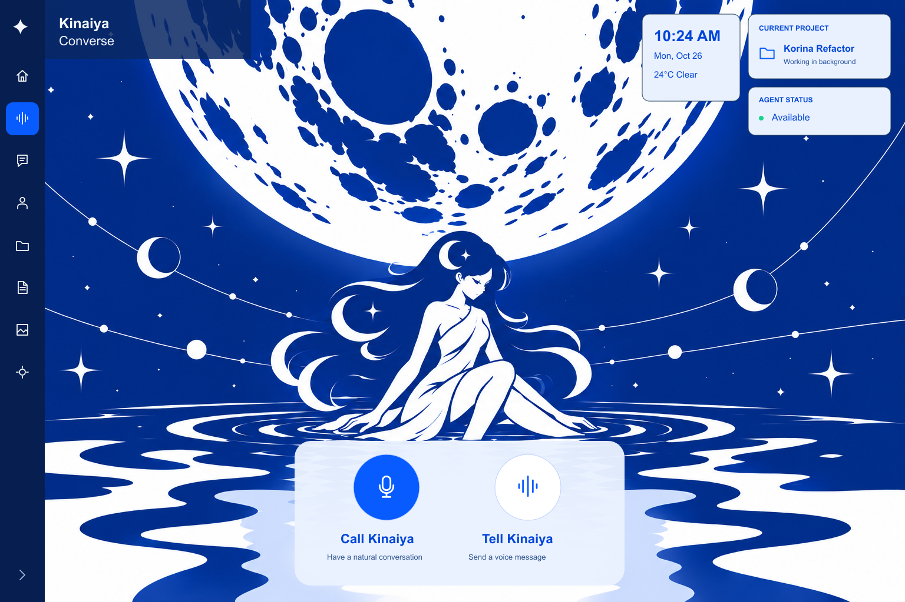
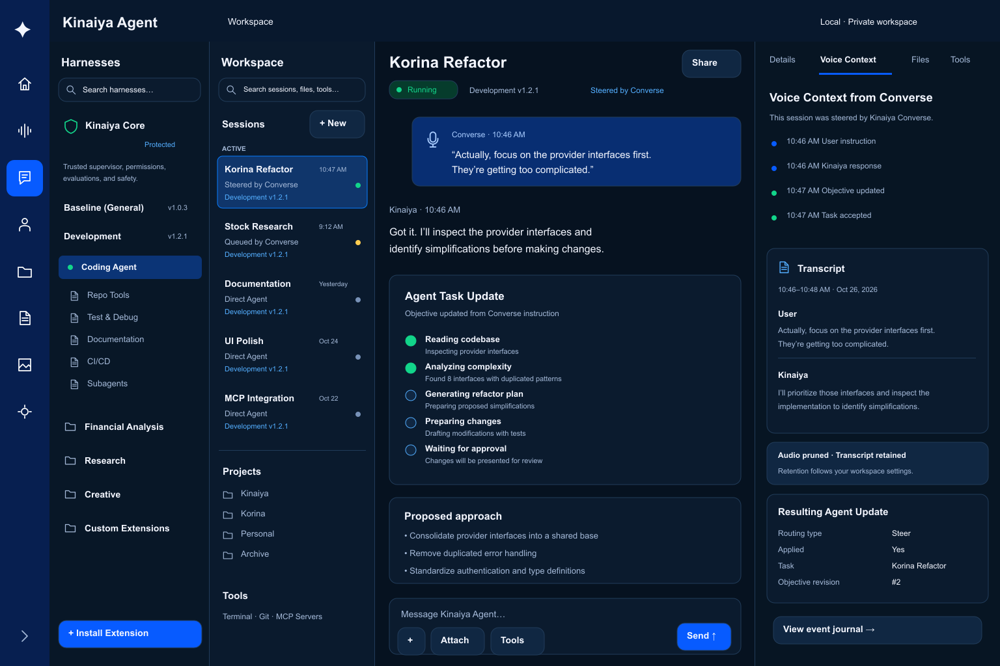

# Kinaiya Penpot design

This folder contains the editable [Converse and Agent Penpot file](Kinaiya-Converse-Agent.penpot).
It is a design draft based on the [Converse](../UIUX%20Concept/kinaiya-converse-moonlit-concept.png)
and [Agent](../UIUX%20Concept/kinaiya-agent-workspace-concept.png) concepts and an
unfinished Figma export. It explores intended interactions; it is not a claim
that every pictured feature is implemented. The project, conversation, file,
media, and status examples are illustrative.

These early desktop exports provide a quick overview; the Penpot file is the
editable source and contains many more screens:

| Converse home | Agent workspace |
| --- | --- |
|  |  |

## Open and edit

1. Install [Git LFS](https://git-lfs.com/) and run `git lfs install`, then clone
   this repository. In an existing checkout, run `git lfs pull`. The Penpot file
   is stored in Git LFS because it exceeds GitHub's regular file-size limit.
   GitHub source ZIP downloads may contain an LFS pointer instead of the design.
2. Open Penpot, choose **Import file** in the dashboard, and select
   `assets/penpot/Kinaiya-Converse-Agent.penpot` from the checkout.
3. Open the imported file and choose a page in the left sidebar. Select layers to
   edit them; use the **Prototype** tab and **View mode** to inspect linked flows.

The consolidated **Kinaiya — Master design** export contains the current
Options overview with Kinaiya cradling a gear in front of the moon, together
with the linked Home, Converse, Agent and Decisions designs. The Options
artwork is a replaceable image; surrounding labels and navigation remain
editable Penpot layers.

The Options overview opens paired sections as separate screens with a Back link:
Models and Providers, Voice and Audio, Agent and Permissions, Tools and
Integrations, Memory and Data, Tasks and Resources, and Appearance and Character.
**Models & providers** contains separate Models, Providers and Harness
Customization pages. The harness list opens dedicated Seed Agent, Research and
Code review editors, with example inherited and custom model settings. The
model dropdown demonstrates changing a selection in each harness. Values are
prototype examples and do not save application settings.

The current provider catalog designs distinguish saved profile declarations from
credential references and immutable generations. Adding a provider profile sticks
to custom OpenAI-compatible `.env` profiles (`#352`) with configurable endpoint
paths (chat completions, models discovery, and optional engine-specific routes
such as `/v1/systemone` on `llama.cpp` vs standard `/v1` on `LM Studio`),
optional maximum output tokens (leaving blank delegates token limits to the
model/engine), per-profile `GET /models` discovery, manual model ID fallback,
masked API key preservation/rotation, and `(provider_profile_id, model_id)` role
identity. Reasoning effort is configured globally or per-model in `Models`
rather than per provider. Saving a profile or discovering
`/models` does not prove readiness or make every adapter eligible for measured
Agent text completion. Credentials are represented by synthetic references or
masked `.env` placeholders; the design contains no real owner key. Earlier Meta
account sign-in explorations are historical proposals, not an implemented
authentication path.

The current Models and Harness Customization boards show host versus exact
catalog-generation selection, unavailable generations, inheritance, dedicated
harness editors and five auxiliary text purposes. Converse, Decisions, STT and
TTS on these boards remain explicitly host-managed; newer runtime increments
require their own design synchronization. Memory demonstrates immutable local
notes, source inspection, revision and dependent-note forgetting.

Permissions now demonstrates Default, Workspace, Session and Task scope for
exact native read_file, write_file and shell rules, with Allow/Ask/Deny or
inheritance. Linked examples include unsaved edits, unknown-save receipt
recovery, same-instance fencing and retired-scope reset. These operation rules
do not imply blanket filesystem or network access. Search and individual MCP
rule designs remain a later increment. Motion-on routes dissolve over 220ms;
motion-off routes are instant. Examples never save runtime settings.

The master design also includes a 14-step interactive **CLI Installer & Setup
Wizard decision tree** (28 paired boards in motion-on and motion-off variants)
covering every choice and branch in `install.sh` and `kinaiya` CLI onboarding
(`#261`, `#335`, `#336`, `#381–#402`):
1. **01 · Bootstrap Entry**: release channel (`stable` vs `nightly`), install root
   location (`~/.local/share/kinaiya` default XDG vs invoking directory `./kinaiya`
   vs custom `--workspace`/`--data-dir`), and human stage progress vs `--json`.
2. **02 · Preflight & APT No-Upgrade Refusal Branches**: absent stable release
   refusal (never falls back to `main`/nightly), strict `apt-get install
   --no-upgrade -o APT::Get::Upgrade=false -o APT::Get::Remove=false` solver
   refusal (`#336`), root/WSL/OS/disk/sandbox namespace denial branches.
3. **03 · Installation Plan Review & `[y/N]` Consent**: `/dev/tty` `y`/`n`/`Enter`
   consent (`#381`), `--yes` non-interactive approval, and `--json` plan output.
4. **04 · 5-Stage Progress & Setup Handoff**: human-readable stage progress with
   quiet log (`~/.cache/kinaiya/install.log`, `#384`), default handoff to
   `kinaiya setup`, `--no-setup`, existing `config.json` preservation, and
   staging rollback on failure.
5. **05 · Cancelled (`[n]`), `--no-setup`, or Existing Config Preserved**:
   non-destructive exit branches where zero files are mutated or existing
   configuration is preserved.
6. **06 · Setup Wizard Mode Choice**: width-aware ASCII mascot (`#386`), Quick
   Setup (`--quick` / `:quick`, `#387`), Advanced Setup (`--advanced`), targeted
   section reconfiguration (`--section`, `#388`), and `:back` / `:cancel`.
7. **07 · Provider Adapter & Model Choice**: local loopback (`lmstudio`,
   `compatible`), remote cloud (`meta`, OpenRouter), searchable model picker
   (`#390`), manual model ID fallback, and adapter validation (`#335`).
8. **08 · Converse Toggle & Independent Per-Role Profiles**: Agent-only default
   (`Converse = n`) vs enabled Converse (`Converse = y`) with independent
   Converse and Decisions adapters, cloud disclosure consent, and credentials
   (`#335`).
9. **09 · Cloud Disclosure (`y/n`) & Credential Branches**: masked API-key paste
   saved to `0600 ~/.config/kinaiya/providers.env` (`#389`), environment variable
   name reference, keeping an existing key, or clearing a saved key.
10. **10 · First-Run Named Custom `.env` API Profile (`#402`)**: creating a new
    named profile (`p01..p07+`) with custom endpoints and optional blank max
    tokens, choosing an existing profile, or skipping without disturbing setup.
11. **11 · Bounded Connection Verification Probe (`#391`) & Final Write `[y/N]`**:
    probe outcomes (`[CONFIGURED · UNTESTED]`, `[VERIFIED · MODEL LISTED]`,
    `[AUTH FAILED · 401]`, `[UNREACHABLE · OFFLINE]`) and final `[y/N]` write
    confirmation.
12. **12 · Setup Completion Summary & Truthful Readiness Badges (`#397`)**:
    written `0600` file summary, truthful `ready: false` badge until host starts,
    and immediate next action branches.
13. **13 · First Session Launch (`kinaiya start`), Auto Local Sign-In (`#393`) &
    `kinaiya doctor` (`#392`)**: one-command local launch (`#395`), single-use
    local owner sign-in exchange (`#393`), trusted local UI auto-connect (`#396`),
    and owner credential rotation (`#394`).
14. **14 · Lifecycle & Recovery CLI Branches**: `kinaiya update --plan` vs
    `kinaiya update`, `kinaiya recover`, `kinaiya rollback --generation <id>`,
    and `kinaiya uninstall` (default data retention vs `--delete-data
    --confirm-data-deletion DELETE`, never deleting `workspace`).

The app implementation follows [ADR 0059](../../docs/adr/0059-home-and-optional-converse.md);
the updated bubbles, transitions and speech behavior follow
[ADR 0060](../../docs/adr/0060-converse-handoffs-and-motion.md).
Unsupported model switching, camera and library controls are not working runtime
features merely because they appear in this prototype.

Text, interface shapes,
controls, and icons are editable Penpot layers. The moonlit illustration and
mascot expression references are replaceable raster images, not editable vector
artwork. The expression boards are static design references, not a playable
sprite animation or a demonstration of live TTS synchronization.

## Page guide

| Page | Purpose and key boards | Design status |
| --- | --- | --- |
| **00 · Home & Converse · Updated** | Moonlit Home, optional Converse, Decisions trace screens, redesigned Options sections with per-harness model choices and Custom `.env` APIs, and the 14-step CLI Installer & Setup Wizard decision tree. | Current owner direction; selected navigation paths and all CLI installer choice branches are linked and values are examples. |
| **00 · Foundations** | Colors, typography and example controls used as a starting point for the design system. | Draft foundation; not a complete component library. |
| **01 · Converse** | Earlier moonlit home, listening state, and an Options copy for the Home flow. | Historical draft; use the first page for the current Options design. |
| **02 · Agent** | Agent workspace while a task runs and a review/approval state, based on the Agent concept. | Concept-based draft; task details and outcomes are examples. |
| **03 · Converse flows** | Voice-message review, text conversation, history, voice options, appearance, microphone unavailable, and memory/privacy. | Draft screens and example states; not all controls are linked. |
| **04 · Agent flows** | Sessions, task details, an action-specific approval review, projects, files, tools and MCP, harnesses, connection settings, and a new-task empty state. | Draft flows; examples do not establish actual service capabilities or task results. |
| **05 · Narrow screens** | Narrow Converse home/history and Agent sessions/approval layouts. | Responsive starting points; other flows and device sizes need further design. |
| **06 · Agent concept** | A separate editable Agent workspace composition following the supplied concept's harnesses, session list, task conversation and voice-context inspector. | Concept recreation; sample content is illustrative. |
| **07 · Options & menus** | Earlier workspace menu and Options explorations. | Historical draft; the current linked Options experience is on the first page. |
| **08 · Projects & workspace** | Project overview, folder contents, file preview, and a new-project form. | Draft. Selected folder and preview paths are linked. |
| **09 · Generated media** | Media gallery, image and audio previews, and an empty state. | Draft. Selected gallery-to-preview and back links are available. |
| **10 · Mascot interaction** | Tell listening and Call listening, thinking, and speaking states using close-up character references. | Static reference boards; labeled preview controls step through selected Call states. |
| **11 · Agent intelligent UI** | Market watcher, solar system, Las Vegas map, spreadsheet and graph, and database comparison shown inside Agent chat, with generated mockups alongside. | Editable concepts; example sessions and database comparison are linked. |
| **12 · Converse intelligent UI** | The same five examples with a transcript mockup above Kinaiya’s corner portrait, plus normal conversation and database comparison states. | Editable concepts; the example selector, database comparison, and return to conversation are linked. |

## Prototype notes

Prototype links demonstrate selected paths rather than every control. On
**00 · Home & Converse · Updated**, the Options gear opens the current overview.
Selecting a paired category opens its first section; the submenu switches
sections or returns to the overview. Harness Customization opens an individual
editor for each example harness, with linked inherited and custom states and a
model selection example. The prototype also links provider setup choices, Custom
`.env` API boards, the 14-step CLI Installer & Setup Wizard decision tree, audio
modes and motion preferences. The
earlier Options copies on **01 · Converse** and **07 · Options & menus** remain
historical drafts and do not update automatically.

The intelligent UI pages include editable interface layers and separate raster
reference boards. The Las Vegas maps are schematic, and transcripts, data and
other controls are illustrative. The example selector, database comparison and
return-to-conversation links demonstrate selected paths; the new links switch
instantly and do not implement the motion preference.

Additional responsive layouts, error and permission states, interaction links,
and refined character animation remain design work. Keep sample labels and
status indicators distinguishable from the behavior of the running product.

## Reviewed native Options and November 2 UI/UX synchronization

The current Git LFS archive is the same **Kinaiya — Master design** file, revision
57, modified `2026-11-03T22:10:00.000000Z`. It contains fourteen pages and 369
real top-level boards (291 on the current page), excluding root sentinels.
Archive size: **232,685,398 bytes**; SHA-256:
`48b3bb4448b9d4bd5155dba59ae34a19efd6cdfaccde8df7c541105ea39b35b2`.

Sixty-two existing Options content areas were updated and sixty-two paired
motion detail/state boards were added in revision 53, revision 54 synchronized
twenty editable text layers across the Home, Converse, Agent and Options
Overview/Models boards (`#286–#310`), revisions 55–56 updated the Provider,
Models, and Home/Character boards (`#352–#353`) and added twelve paired Custom API
prototype boards (`#352`), and revision 57 adds twenty-eight paired CLI Installer
& Setup Wizard prototype boards (`#261`, `#335`, `#336`, `#381–#402`: 14 motion-on
and 14 motion-off screens linking every choice and branch in `install.sh`,
`kinaiya setup`, `kinaiya start`, `kinaiya doctor`, `kinaiya auth rotate-owner`,
`kinaiya update`, `kinaiya recover`, `kinaiya rollback`, and `kinaiya uninstall`).
All prior real board identities, names and geometry remain; the other thirteen
pages and all 100 uploaded artwork metadata/blob paths remain byte-exact.

Selected Models, Providers, Custom API `.env` prototype flows, CLI Installer &
Setup Wizard branch flows, profile editing, Permissions, Task edit and unknown
receipt paths were reviewed. Offline archive analysis resolves 1,126 native
Options, 230 scoped permission, 286 Custom API prototype, and 702 CLI Installer
prototype links. This does not claim every prototype control was exercised or
runtime acceptance completed. See the
[review record](options-sync-review.json) and
[synchronization notes](../../docs/penpot-options-sync-plan.md).
