# Kinaiya application screenshots

## November 1, 2026 — refreshed interface

These captures show the running Flutter web app after the Agent workspace and
Options UI refresh. Services are disconnected, so model controls and task
execution are unavailable. No conversations, credentials, or fixture task
results are shown. Select an image to open the complete capture.

| Home | Converse | Agent workspace |
| --- | --- | --- |
|  |  |  |
| Character hub with no Agent session selected. | Character and conversation view, with no model connected. | Resizable sidebars, task details, and an empty workspace. |

| Options | Models | Connection |
| --- | --- | --- |
|  | <a href="2026-11-01-ui-refresh/models.jpg">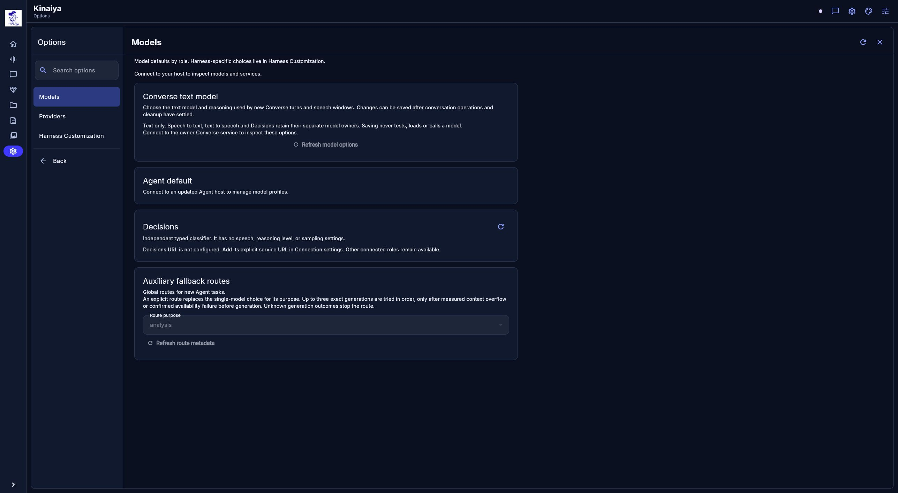</a> | <a href="2026-11-01-ui-refresh/connection.jpg">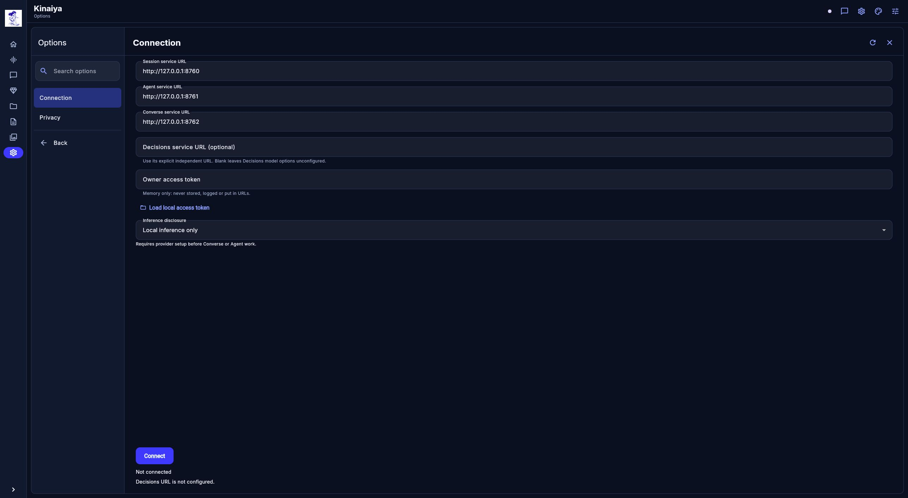</a> |
| Category navigation and artwork. | Role-specific settings in the disconnected state. | Service connection and disclosure settings. |

The captures came from source [`5b2513d8a1cf463947047f88706117a1c31fc42f`](https://github.com/rgoza1996/Kinaiya/commit/5b2513d8a1cf463947047f88706117a1c31fc42f),
which includes the merged Agent UI refresh. They are complete browser JPEGs,
without cropping, retouching, resizing, or re-encoding. The
[capture manifest](2026-11-01-ui-refresh/manifest.json) records their hashes,
dimensions, and preview conditions. These images demonstrate the interface,
not live model readiness or completed work.

Earlier November 1 settings preview (before the UI refresh)

## November 1, 2026 — earlier settings preview

These are raw captures of the running Flutter application in the Settings integration preview. The preview exposes fixture model metadata and an empty Agent workspace. Capture involved inspection only: no inference, audio, task execution, model loading, or settings save. No generated conversation or task result is shown.

Select any image to open its complete JPEG.

### Conversation and work

| Converse | Agent workspace | Options |
| --- | --- | --- |
| <a href="2026-11-01/12-converse.jpg">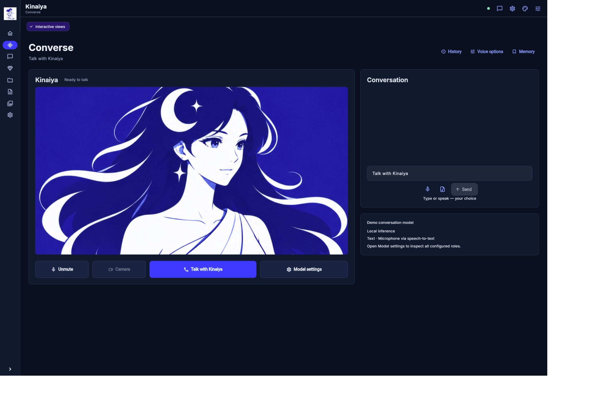</a> | <a href="2026-11-01/07-agent-workspace.jpg">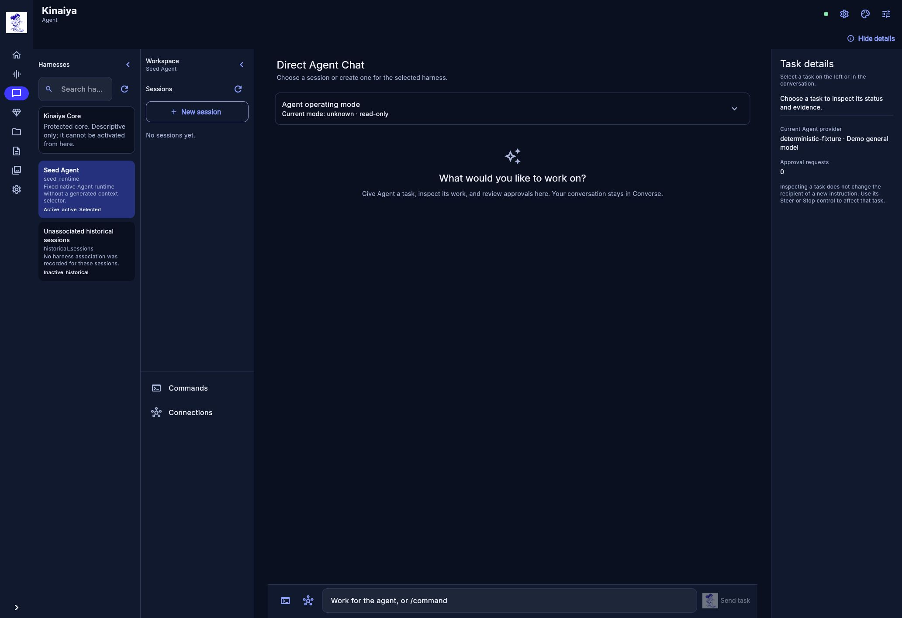</a> | <a href="2026-11-01/10-options-connected.jpg">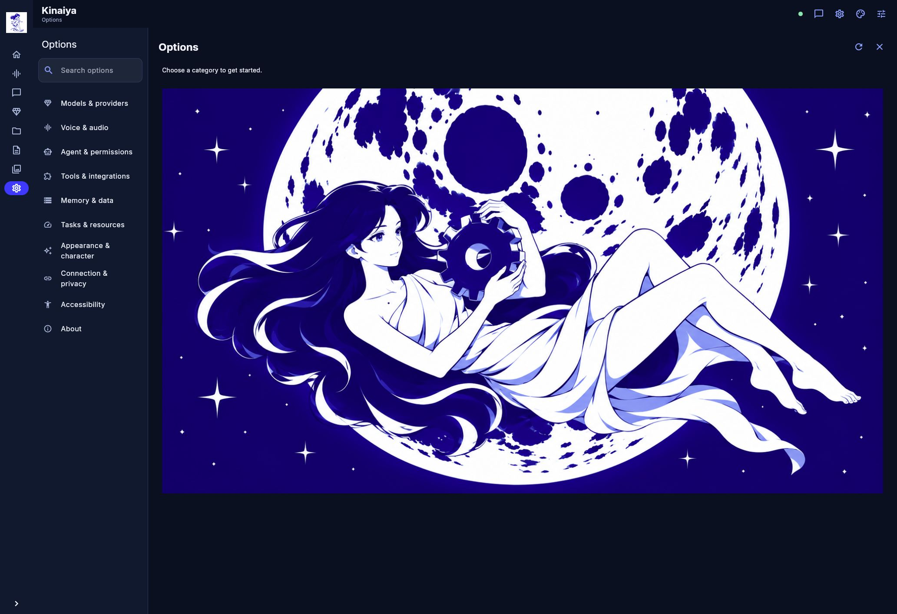</a> |
| Character and conversation view, with fixture model labels. | Seed Agent selected, no sessions, and operating mode visibly unknown/read-only. | Category navigation for the embedded settings pages. |

### Home and model controls

| Home | Floating controls | Models |
| --- | --- | --- |
| <a href="2026-11-01/08-home-connected.jpg">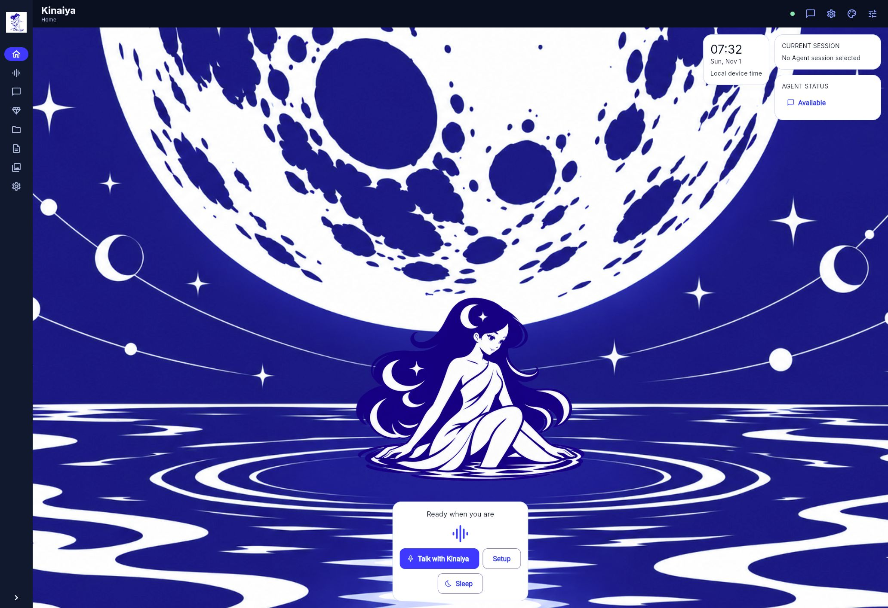</a> | <a href="2026-11-01/09-floating-bubbles.jpg">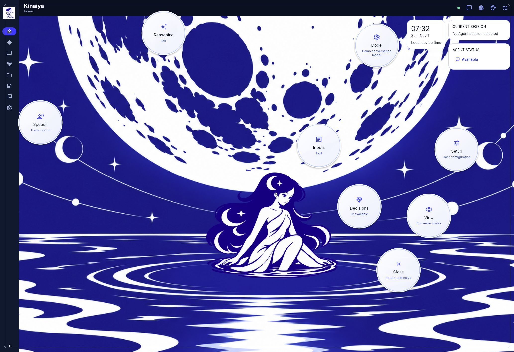</a> | <a href="2026-11-01/04-models.jpg">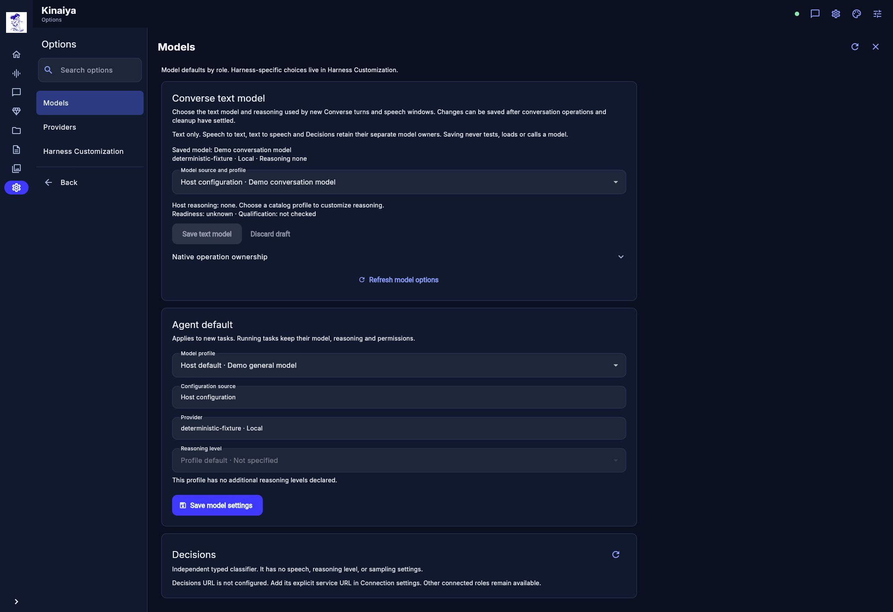</a> |
| Character hub and conversation controls. | Setup bubbles, including the unavailable Decisions state. | Role-specific configuration; readiness and qualification remain unknown in this capture. |

### Availability, permissions and build

| Tools | Permissions | About |
| --- | --- | --- |
| <a href="2026-11-01/05-tools.jpg">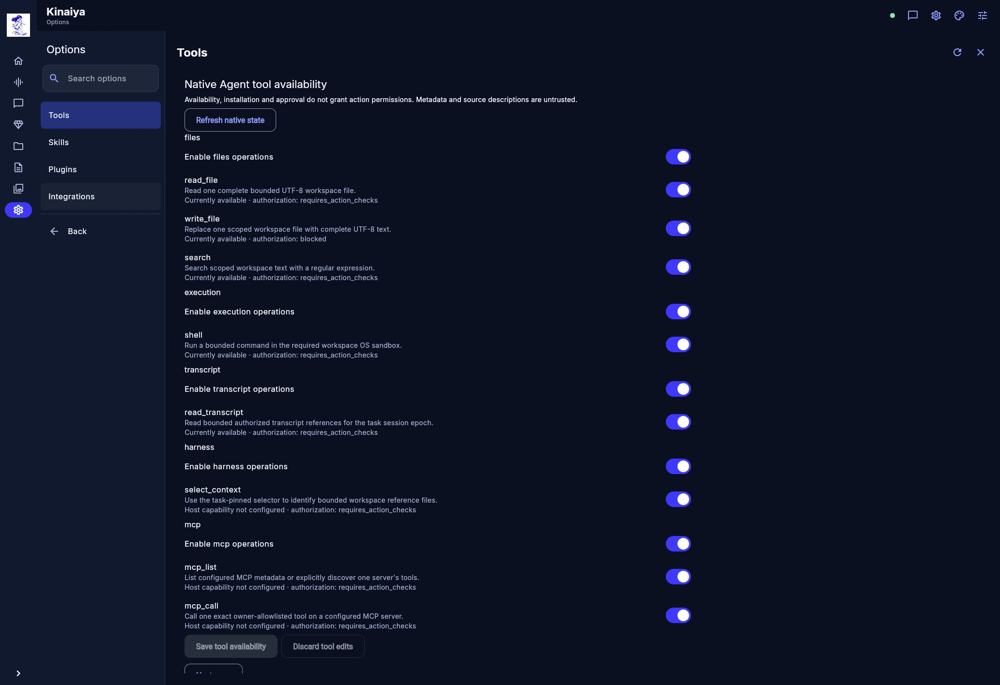</a> | <a href="2026-11-01/06-permissions.jpg">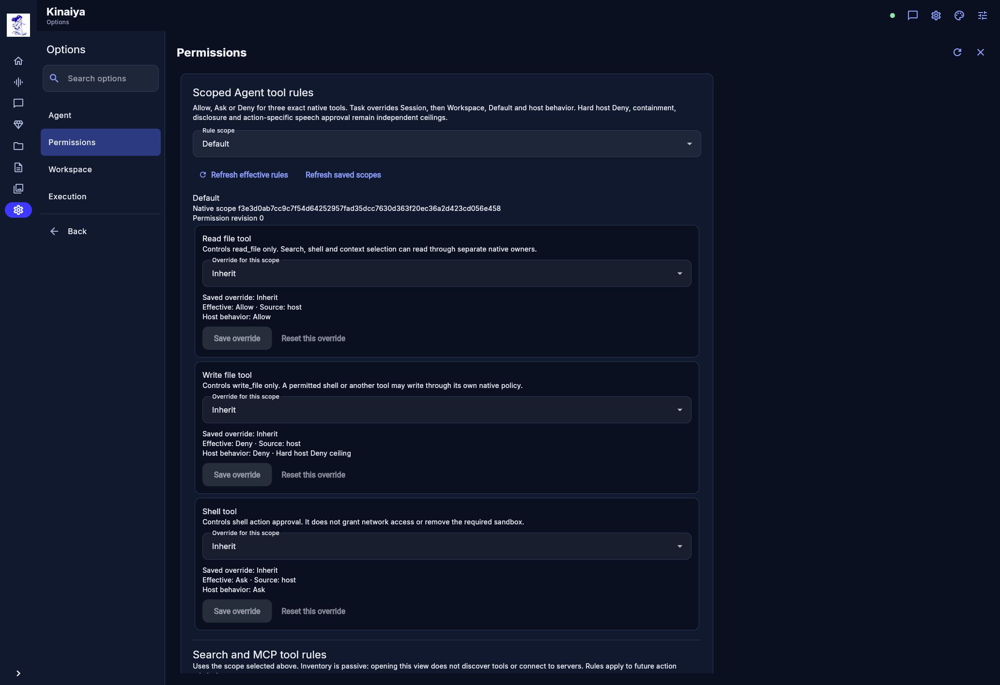</a> | <a href="2026-11-01/11-about-connected.jpg">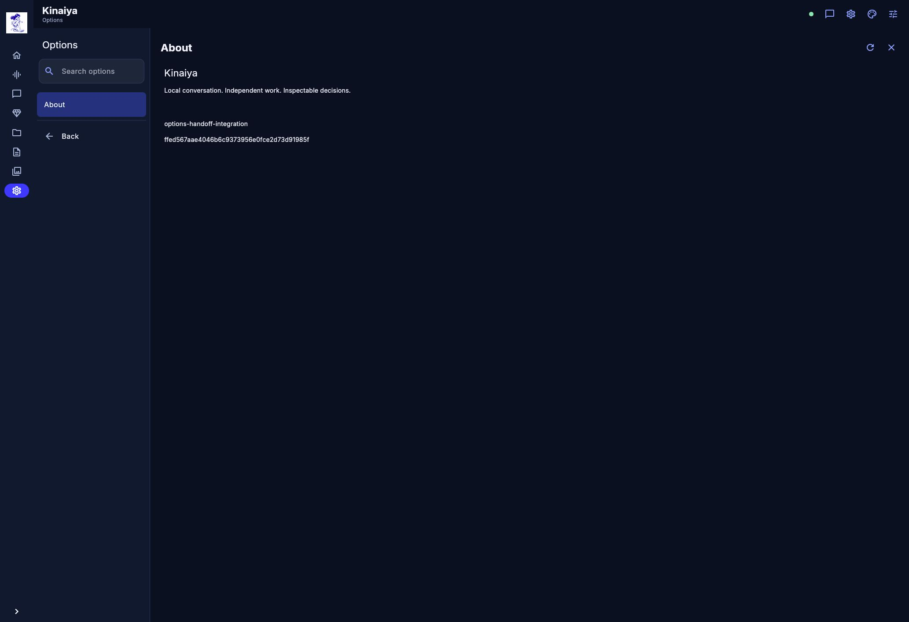</a> |
| Availability is shown separately from action authorization. | Default scope with inherited Allow, Deny and Ask rules. | `options-handoff-integration` build and its source identity. |

### Capture provenance

- The captured source is [`ffed567aae4046b6c9373956e0fce2d73d91985f`](https://github.com/rgoza1996/Kinaiya/commit/ffed567aae4046b6c9373956e0fce2d73d91985f), also visible in About. Its Flutter tree is byte-identical to publication base [`c4d86bf`](https://github.com/rgoza1996/Kinaiya/commit/c4d86bf0a6ccbf155d9a3035633d16d0600eabc1); the intervening changes are documentation and recovery tests.
- All nine JPEGs retain their original complete bytes, without cropping, retouching, resizing, or re-encoding. Eight are 2065 × 1416 pixels; Converse is 2293 × 1573.
- Home's visible device clock reads 07:32 on Sunday, November 1. Connection indicators and model labels describe the preview's fixture state; these images do not establish production readiness or completed work.
- The [capture manifest](2026-11-01/manifest.json) records the view glossary, source, file hashes, dimensions, file timestamps, and provenance record time. File timestamps are labeled separately from the capture date.

## Home — October 30, 2026

[kinaiya-home-2026-10-30.png](kinaiya-home-2026-10-30.png) is an owner-supplied capture of the implemented application, preserved without cropping, retouching, or fabricated UI.

- The screen shows Home, the character artwork, sidebar navigation, and floating setup controls.
- Its visible clock reads 19:30 on Friday, October 30. The supplied file was received October 31 at 02:31 UTC.
- Agent is visibly not connected; unavailable controls remain visible.
- The image is 2047 × 863 pixels. Its application source revision is not embedded and cannot be established from the capture.
- SHA-256: `9cb4b3089bea44ccf4fbe5d66e12d3cb09c045be585b8b1a31d8452feab4ce68`.
- This is a dated interface snapshot. It does not show the later independent role editors or the complete November 1 Options integration, and it is not evidence of live speech, model readiness, or task completion.

The [Penpot exports](../penpot/README.md) and [UI/UX concepts](../UIUX%20Concept/) are separate design references. Do not label them as application screenshots.

When adding captures, use the running application, retain the visible state, record the date and source revision when available, and exclude private conversations, credentials, and personal account data. Use actual Home, Converse, Agent, and embedded Options views; no generated conversation or result should be presented as a completed task.
