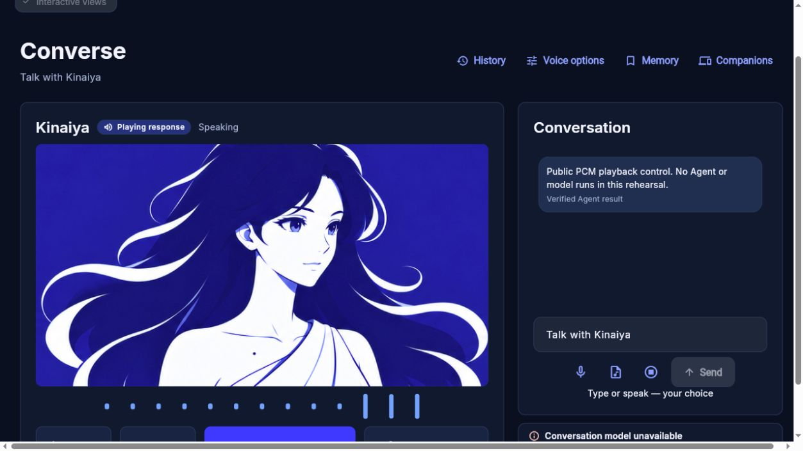
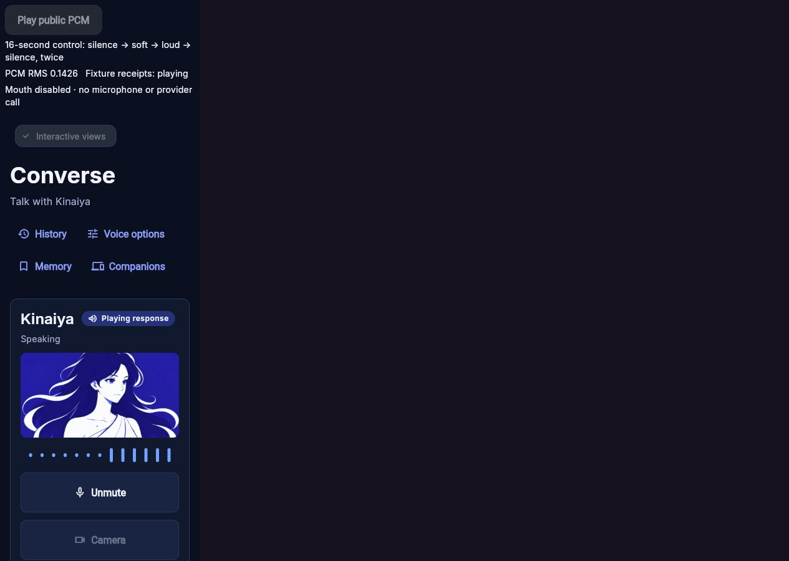
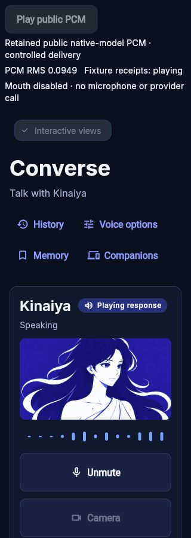
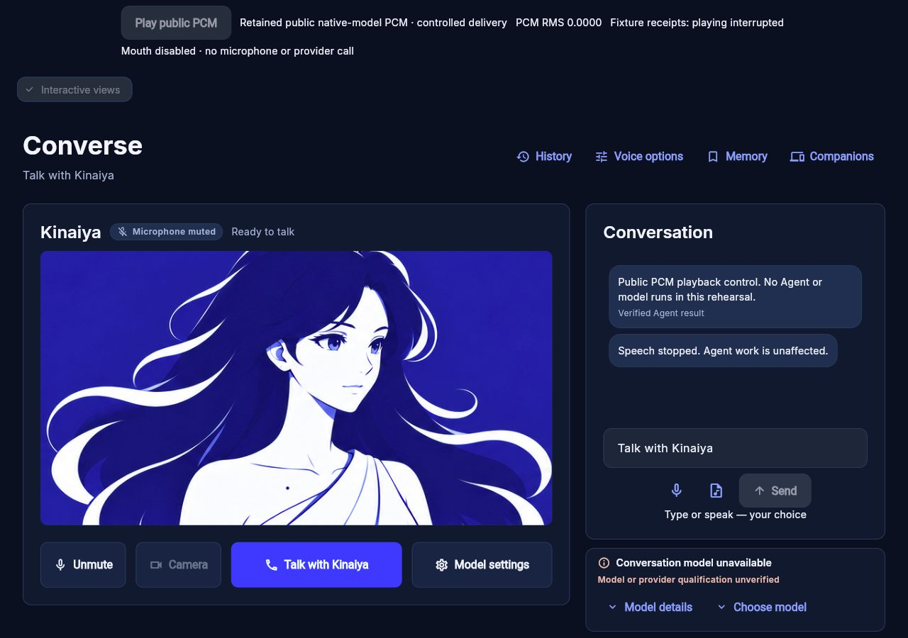
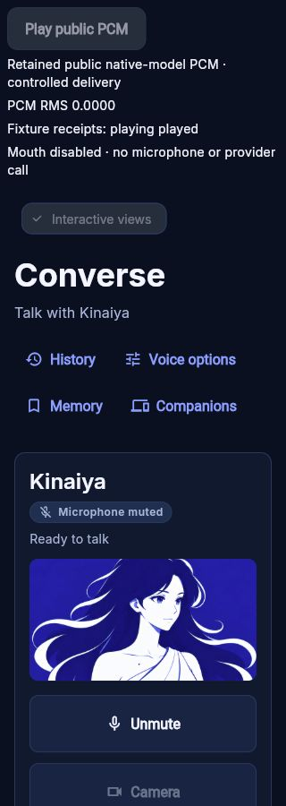

# Converse visualizer verification, November 14, 2026

Issue #606 replaces fixed bars with thirteen recent PCM RMS measurements. The
browser rehearsal uses the actual compiled CharacterView, Dart/JS adapter and
Web Audio bridge. Its service responses are controlled, in-memory public
fixtures; there is no live provider, Agent, microphone or owner-service change.

At actual 1280×900 and 320×900 iframe viewports, the control plays sixteen
seconds of silence → soft → loud → silence, twice. Browser observations and
unchanged screenshots show shorter bars for soft PCM, taller bars for loud PCM,
and a quiet baseline for silence. Mouth motion is disabled throughout.

| Soft output | Loud output |
| --- | --- |
|  |  |
|  |  |

The retained public native-model `work-output.wav` from the current #483
qualification was also played through this controlled delivery fixture. Its
original SHA-256 is
`aa9378b940340a5d0c15fdb64bb10cb9246dee59ae6c9afc6a39e32eb437ff0d`;
the 12.48-second mono 24 kHz PCM is unedited. Its RMS changes and irregular bars
were observed at both widths, independently of optional mouth motion.



Desktop Stop removes the waveform and reports `interrupted`, without claiming
`played`. Narrow natural completion reports `played`, shows RMS zero and removes
the waveform. These are fixture/client reports, not physical audibility proof.
The model's original handoff-quality failure remains tracked in #483. The
browser's stored-PCM delivery is separate from actual native admission, which
the widget regression covers with the real owner/currentness logic.




The [manifest](manifest.json) records source/build/sample and screenshot hashes,
actual checks and limitations. The first temporary HTTP server ended with exit
143; its connection-refused reload was retained. A fresh owned PTY server
served these checks and was explicitly stopped. An offscreen narrow Stop
locator could not be clicked; desktop Stop and widget ownership checks passed,
and narrow natural completion was observed. One unattributed MutationObserver
console error appeared during narrow setup; clean-console behavior is not
claimed. Rehearsal tabs were closed except the obsolete first error page,
whose closure was blocked by browser URL policy and left to temporary cleanup.

The initial full Flutter run passed 1,464 tests with exit 0. After adding and
repairing the delayed-playing/source-identity boundary, the integration suite
passed thirteen tests. A subsequent full run printed 1,465 passing tests but
its command ended with exit 143; that termination is preserved and is not
reported as a clean run. The separately owned, bounded audit then passed all
**1,465 Flutter tests with exit 0**, no received signals and no deadline expiry
(210.245 seconds). The earlier terminated invocation remains recorded. The Node
bridge suite passed **110 checks**. Analysis and the main, companion and
rehearsal release-web builds passed; the existing missing
CupertinoIcons font-family warning remains visible.

To reproduce the controlled browser path using the pinned cached environment,
from `apps/kinaiya_flutter`:

```sh
flutter build web --release --no-pub --no-web-resources-cdn -t test_support/speech_visualizer_browser.dart --output build/visualizer-rehearsal
python3 -m http.server 0 --bind 127.0.0.1 --directory build/visualizer-rehearsal
```

Open the reported loopback port, enable accessibility if using automation, and
click **Play public PCM** once. Use a fresh page for another control. For the
retained speech case, copy the unedited public WAV as `native-speech.wav` into
that isolated build directory and open `/?sample=native`. The recorded fixed
widths used ordinary iframes; responsive widget checks also cover 320 px.
This entry point is a test fixture and is not the production app entry point.
