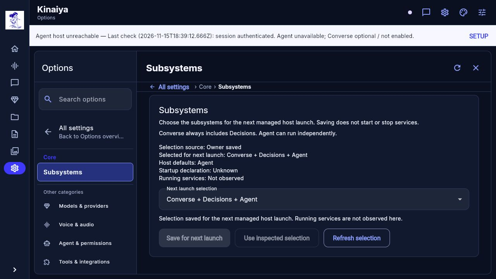

# Core Options verification (#566 / #567)

Runtime source: clean commit
`f8bbd1fc2a653be68b130a384892eb1c90df0f96`, stacked on Core owner draft
`98434af9dae0f12b25bc93938fe87c2199b965b4`. The later evidence/documentation
commit does not change runtime code.

[Check history](check-history.json) preserves first failures and final results:
missing feature imports; missing mock-facade injection; actual narrow-shell
overflow; two missing authority guards; and a fixture's cross-thread SQLite
ownership error. The scroll helper was corrected to settle layout before a
strict tap, with real selection/containment assertions retained. Menu rows also
allow intrinsic height. Existing test files were not rewritten.

The final complete Flutter suite passes **1,495 tests / one skipped**.
The environment-gated live case separately passes **one test in 3.09 seconds**.
Analysis is clean; web release build, Ruff and schema export/diff checks pass.
The build retains its nonfatal existing Cupertino font-family warning and a
successful Wasm dry run; this is not Wasm runtime qualification.

With the pinned Flutter SDK on PATH, run the actual interoperability fixture:

```sh
PYTHONPATH=. python -m pytest -q tests/integration/test_core_subsystem_dart.py
```

It starts the original Session/Core owner on its own server thread and runs
`test/core_subsystems_live_test.dart` against real loopback HTTP. Six mode
changes plus host reset commit seven revisions. Six positive exact replays add
no revision; seven lookups verify Python/Dart request digests. A stale change
receives 409 and its lookup proves a fence. Agent credentials receive 403.
Host config bytes stay exact and the original thread joins. CI runs this
separately in the Flutter job; Python-only jobs may skip it without the SDK.

## Built app and interrupted original

The actual release app used normal Advanced connection to a private temporary
Session/Core with public synthetic credentials and no Agent/model services.
Core remained accessible and saved all six modes, reporting next-launch state
and running services as unobserved. Captures cover 1280×720 and 320×640:



The original temporary server exited **143 / SIGTERM** during host reset.
Signal origin is unproven; no final cleanup receipt exists. The UI retained its
exact original as unconfirmed, without a replacement write.
[First interruption](first-interruption.json) and
[initial source pins](first-started.json) retain that result.

A replacement reused the same protected store, host file, origin and backend.
Generation advanced from one to two. Exact lookup returned **unobserved +
mutation_fenced=true** for the generation-one original. The UI retained its
draft, disabled Save, and required inspected state before a new request. A fresh
generation-two host reset committed revision seven under a different key.
[Native proof and receipts](browser-recovery-proof.json) retain both originals
and their distinct outcomes.


[Replacement receipt](replacement-receipt.json) verifies unchanged source hashes
and host bytes, returned server run, joined watcher, zero model calls and zero
Agent tasks. Both PIDs were observed absent; the replacement exited zero.
Viewport override was reset and the created browser tab closed.

The `.py.txt` helpers retain actual commands/paths, including the interrupted
helper. The replacement records Core requests incrementally and preserves an
owned SIGTERM handler so shutdown can emit its receipt. It does not weaken
native guards or repair the first run's evidence. Raw output remains under
`output/issue-566-core-options/`.

No installed owner service/configuration, model/default, execution permission,
audio device or third-party Agent changed. Full consumer-policy and lifecycle
acceptance remains open under #566/#567.

## Reporter compatibility follow-up (#634)

The first PR #632 workflow at `385d0af503ae6ff966726d6d862ec9afa3d12edc`,
run `43750683316`, Flutter job `132923724847`, passed 1,495 Flutter cases
(one live-only skip) and the preceding companion native interoperability case.
The new Core native Dart subprocess also exited zero and reported one passing
case. Its Python wrapper then failed because GitHub's default reporter prints
`1 test passed.` instead of the expected local `All tests passed!`.

The unchanged wrapper reproduced the same failure locally with `CI=true
GITHUB_ACTIONS=true`: one failure in 3.12 seconds. Selecting the documented
`--reporter expanded` preserves the success-text and exit-code checks and all
native assertions. The actual Dart/Core fixture then passed in that same
environment (one case, 2.86 seconds) and in the normal environment (one case,
2.66 seconds). No product or SDK behavior changed. Full exact-head CI has not
yet completed for this follow-up. Raw first/final logs remain under the local
`output/issue-566-core-options/` evidence directory.
