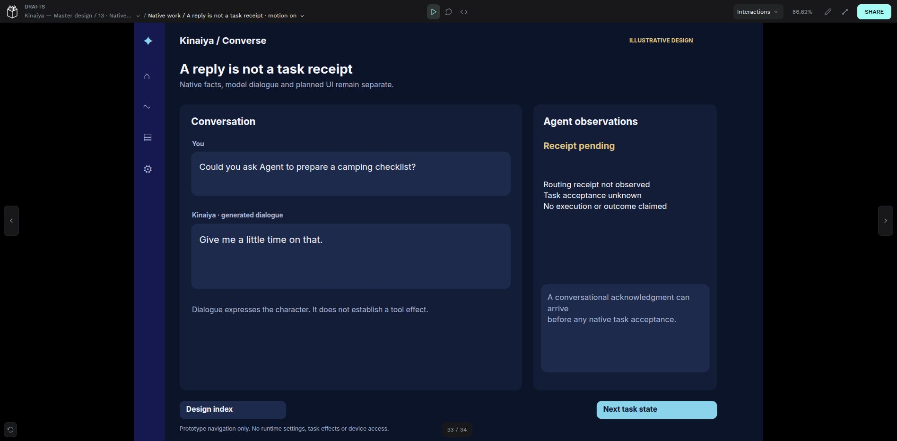
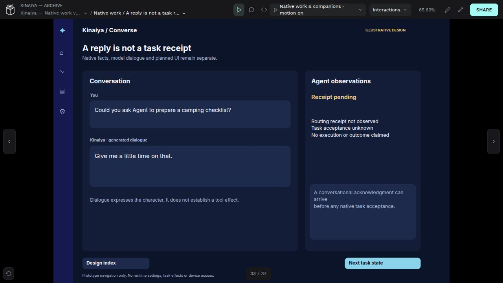

# Native work and optional companion design synchronization

This is the November 14 baseline record. The later
[architecture responsibility copy correction](penpot-architecture-copy-sync.md)
updates the two overview footers and the current archive identity while
preserving every other prepared archive member. The baseline results below
remain historical evidence.

The repository's canonical `assets/penpot/Kinaiya-Converse-Agent.penpot` now
contains a new **13 · Native work & companions** page. The owner's canonical
master in **local Penpot at [localhost:9001](http://localhost:9001)** has also
been updated through the native editor. Check port 9001 and the existing signed-in
workspace first on future design work. This supports issues #476–#587 while
preserving the earlier designs; no cloud Penpot revision was changed.

Source: 244,662,707 bytes, SHA-256
`1fa59798c57172b75afb527a671a44dc44e9c9509d7b4a496030b13f2683b59c`.
Result: 245,704,624 bytes, SHA-256
`a32eb13839d17d524a3251870655640a3b4e44318f06a4ae555c75c1d74c84bd`.
Master file ID remains `aed0c863-4a2a-8195-8008-defdd82e75a3`.
Prepared archive page ID: `3d154fd3-c631-5f34-bf0e-4efa76283a20`.
Canonical local master page ID: `539d030b-728d-808b-8008-f29cdb0cd579`.
The native clipboard transfer remaps new shape IDs and offsets their positions
by `(282, 350)`; it does not change the original pages.

## Requirement and design mapping

| Owner requirement / issues | New design behavior | Qualification boundary |
| --- | --- | --- |
| Native handoff and status: #483, #485–#486, #559 | Seven task states distinguish generated receipt, native acceptance, pending steer, failed partial work, UI publication, execution receipt, received outcome and unavailable observations | Illustrative public dialogue; no new model-quality pass or execution fact |
| Editable model preferences: #557–#559 | Separate Converse and Decisions natural-language instruction concepts; configurable handoff preference without mandatory silence, permissions or success authority | Converse host configuration merged in #589; Decisions host configuration merged in #601. GUI editors remain proposed |
| Native health/audio: #477, #560 | Configuration, native transport admission and actual quality remain separate; whole-utterance buffering, 30-second refusal and no silent text/TTS fallback are explicit | Does not claim duplex, browser/device qualification or an engine repair |
| Independent deployment and external Agent: #547–#548, #553, #556, #568 | Agent + Converse, Agent only and Converse only remain distinct; planned Pi bridge does not imply native task execution | No new topology/bridge implementation or installed service change |
| Mobile companion: #549–#552, #556 | Explicit host pairing, local offline transcript, receipt-based catch-up, visible history gaps and deliberate foreground voice controls | No account/device credentials, working transport, VPN setup, microphone or Android service claim |
| Saved creations and web artifacts: #554–#555, #561 | Creations retain task/session/revision provenance; UI publication is separate from execution; reopening must not replay effects | Planned organization; does not promote rendered UI to native completion evidence |

## Archive and prototype checks

- All **49,093 original archive members** remain byte-for-byte identical,
  including all 14 original page payloads and existing shapes/media/thumbnails.
  No original board identity, geometry, interaction or illustration changed.
- Exactly **1,222 new members** add one page and its native shapes. There are
  **34 new boards**, 744 native editable text shapes, and 136 prototype links.
  The complete master has 15 pages and 403 real boards, excluding root sentinels.
- Every new child belongs to its actual parent frame and fits inside that
  frame's declared geometry. Every new navigation target resolves to a real
  board. Motion-on links use 220ms dissolve/ease-in-out; motion-off links omit
  animation. Desktop boards are 1536×1024; mobile boards are 420×900.
- ZIP CRC checks pass. There are no duplicate or traversing member paths.
  No flattened screenshot replaces editable controls. Four versioned SVG
  previews are rendered from the same added native text/vector records.
- The design index, running-task/pending-steer view, Converse instructions and
  mobile offline catch-up were visually checked in a browser. Browser fonts can
  fall back to system fonts; native text records use the master's Inter family.
  This is selected preview verification, not exhaustive interaction testing.
- The exact LFS object was uploaded by the normal repository-authenticated
  batch/basic protocol. Its complete remote download matched the declared byte
  count and SHA-256 before the repository pointer was prepared.

The [machine-readable review](../assets/penpot/native-work-sync-review.json)
retains board identities, archive comparison counts and the bounded publication
receipt. It contains no credentials or signed URLs. The earlier
[Options synchronization record](penpot-options-sync-plan.md) remains historical
evidence for the unchanged 14-page source.

The first native-work candidate used `type` for its 68 new animated transitions.
An audit against the exact producer version's
[Penpot 2.18.5-RC1 animation schema](https://github.com/penpot/penpot/blob/f44566963daf61fce4d8608e7c5e8c27c5853a88/common/src/app/common/types/shape/interactions.cljc#L75)
found that the required discriminator is `animationType` (#598), as in the
original master. The second candidate corrected those 68 added shape members.
Its native import rendered, but prototype clicks remained on the overview (#603).
All 136 link rectangles had no fill or stroke, so the browser hit the lower
painted background instead. Adding a native fill at zero opacity to one link
made it receive the pointer and navigate. The third candidate adds the same
`#B1B2B5` / `fillOpacity: 0` fill to exactly 136 added shape members. All original
members and the SVG previews remain unchanged. The review record retains both
failed candidates' hashes and publication receipts.

## Local native verification

On November 14 locally (November 15 UTC), the signed-in local master was pinned
as **Before native work & companions (#590)** and that version was locked. A
new page received all 34 boards through Penpot's native clipboard. The transparent
fill correction was applied to all 136 hotspots through native controls, and
both named prototype flow starts were created. A native export independently
confirmed:

- 15 pages and 403 boards; all 14 original page records and 48,017 original shape
  records compare structurally equal, with every field retained in the comparison.
- The added 34 boards, 744 text contents, parent/frame mapping, common position
  offset and all 136 remapped destinations match the prepared page.
- Every added hotspot has the zero-opacity fill; 68 links retain 220ms dissolve
  and the other 68 are instant. Both flow starts resolve to the paired overviews.
- ZIP CRC and unique-member checks pass. Native export reserializes JSON and
  regenerates thumbnail objects; it is not byte-identical to the prepared archive.

Native master clicks exercised overview → pending receipt → running/pending
steering → failed partial work → overview, mobile offline catch-up and the
motion-off overview → receipt path. The exact third archive was then imported
separately, opened in the editor, and its overview → receipt hotspot was clicked
successfully. Open the imported page in the editor before the first preview to
let Penpot calculate text layout; the initial direct cold viewer showed shapes
without text. These are selected checks, not all 136 links manually exercised.

The qualification files remain in **Kinaiya — Archive**, distinctly named
**Native work v2 · failed hotspots (#603)** and **Native work v3 · import verified
(#590)**. The v2 copy includes the single controlled native fix; the original
failed archive is retained separately. Canonical master file identity is unchanged.

Native master export: **245,558,625 bytes**, SHA-256
`f832e651a39437fcf883176385c10652f57f9a0aa11e6651d4d9d3ade6f1f8d6`.
The bounded export receipt and screenshot hashes are in the machine-readable
review. Full exports remain local evidence.

## Remaining acceptance

The prepared archive intentionally retains its source revision metadata; the
separate native export and actual local editor checks establish the local update.
The complete Penpot schema was not executed as a standalone validator. No new
service feature, actual speech quality, mobile connection, hardware playback or
task success is established by these design references. The pictured visual
instruction editors, external bridge and mobile transport remain proposed.
